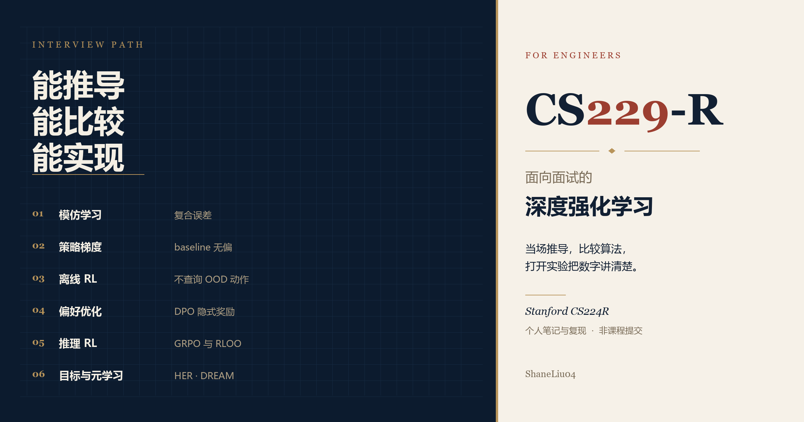
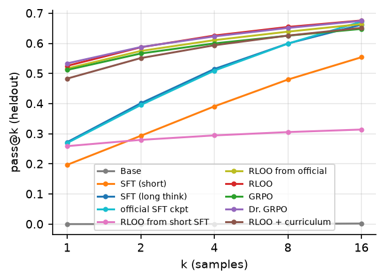

# CS229-R



面向面试的深度强化学习。笔记、公式和多种子实验只为一件事服务：当场推导，比较算法，把曲线上的数字讲清楚。

材料来自 Stanford CS224R（Chelsea Finn，2026 / 2025 / 2023）。作者 [ShaneLiu04](https://github.com/ShaneLiu04)。与 Stanford 及课程团队无隶属关系。`solutions/` 是个人复现，正在修读该课的同学不要把它当作作业提交。

## 三张图

留出集 500 题，每题 16 条。长 think SFT 的 pass@1 是 0.272，pass@16 是 0.662。长程 RL 把 pass@1 抬到 0.52–0.54，pass@16 停在 0.64–0.71。面试里把这件事讲成分布变尖：小 k 上升，大 k 没有拉开。



同一份 Medium 迷宫。IQL（ζ=0.7）在 RND 数据上是 −50.9，在随机数据上是 −90.7。CQL（α=0.1，6 个种子）反过来：随机数据 −34.3±6.1，RND 数据 −67.6。数据没有绝对的好坏，要看算法怎么用它。starter 里的 `--use_rnd` 并不改变数据，采集器写死了最短路贪心。


bit-flip 的奖励只有 0 和 −1。无 hindsight 时 25-bit 成功率是 0。final、future、random 三种重标记都到 1.0。


网格上走路是 0.1，读地图再坐公交是 0.7。DREAM 0.696±0.007，RL² 0.143±0.073。把每步探索代价设为 0，回报仍是 0.70，探索长度顶到回合上限。

## 开口的一句

往下的推导在笔记，90 秒的讲法在 [作品集](interview/PORTFOLIO.md)，可手推的步骤在 [公式卡](interview/FORMULAS.md)。

| 模块 | 开口 | 笔记 | 证据 |
| --- | --- | --- | --- |
| 模仿 | MSE 在多峰动作上取条件均值，落到数据没有的动作上。测试时状态偏离训练集，误差随步数复合。 | [L2](notes/lecture-02-imitation-learning.md) | [HW1](solutions/spring2026/homework1-imitation/README.md) |
| 策略梯度 | `t` 之前的奖励与 `a_t` 独立，那一项的梯度期望是 0。只依赖状态的 baseline 同样无偏。 | [L3](notes/lecture-03-policy-gradients.md) | [公式卡](interview/FORMULAS.md) |
| GAE | `λ=0` 是一步 TD，`λ=1` 回到 reward-to-go。中间换的是偏差和方差。 | [L4](notes/lecture-04-actor-critic.md) | [HW2](solutions/spring2026/homework2-online-rl/README.md) |
| PPO / SAC | clip 限制的是 `π_new/π_old`。两个 Q 取 min 是往下偏，用来压过估计。 | [L5](notes/lecture-05-off-policy-actor-critic.md) | [HW2](solutions/spring2026/homework2-online-rl/README.md) |
| Q-learning | `max` 作用在带噪声的估计上，`E[max Q̂] ≥ max E[Q̂]`。 | [L6](notes/lecture-06-q-learning.md) | [HW2](solutions/spring2026/homework2-online-rl/README.md) |
| 离线 | IQL 用 `V(s')`，不在下一状态采样动作。同一份 RND 数据对 IQL 更好，对强 CQL 更差。 | [L7](notes/lecture-07-offline-rl.md) | [2026](solutions/spring2026/homework3-offline-rl/README.md)、[2025](solutions/spring2025/homework3-offline-rl/README.md) |
| 偏好 | KL 约束下的最优奖励是 `β log(π/π_ref)`。配分函数在两条回答相减时消掉，所以损失可以直接写在策略上。`β=0.1` 且策略等于参考策略时，IPO 损失是 25。 | [L9](notes/lecture-09-rlhf-preference-optimization.md) | [Countdown](solutions/spring2026/default-project/README.md) |
| 推理 RL | RLOO 不除组内标准差，GRPO 除。低方差的题（几乎全对或全错）会被放大。损失再按长度平均，长的错误回答每个 token 分到的梯度更小。 | [L10](notes/lecture-10-rl-llm-reasoning.md) | [Q13](interview/QUESTION-BANK.md) |
| HER | 把目标换成后来实际到达的状态。确定性环境里转移不变。随机环境里，到达这个状态的转移是在原目标下发生的。 | [L12](notes/lecture-12-multi-task-goal-conditioned-rl.md) | [HW4](solutions/spring2025/homework4-goal-meta-rl/README.md) |
| 元学习 | DREAM 用信息增益减去每步代价来学探索。RL² 把探索和执行放进同一个 RNN，信用分配要穿过整段历史。 | [L13](notes/lecture-13-meta-rl.md) | [HW4](solutions/spring2025/homework4-goal-meta-rl/README.md) |
| 系统 | 0.5B、AdamW、bf16：权重 1 GB，fp32 主权重 2 GB，两个矩 4 GB，梯度 1 GB，共 8 GB。训练进程留下的约 89 GB 是缓存，不是 KV。vLLM 按整卡容量申请，同卡起不来。 | [工程手册](interview/ENGINEERING.md) | [故事 2](interview/PORTFOLIO.md) |

2026 版没有 exploration。 [L14](notes/lecture-14-exploration.md) 按 2025 版补了 RND、ICM 和计数，对应上面的探索数据实验。一句话答案的全表在 [课程问答](interview/COURSE-QA.md)，每节末尾的错答在 [题库](interview/QUESTION-BANK.md)。

## 怎么准备

90 分钟只准备两个故事，再默写对应公式。算法岗用 [故事 4 和 5](interview/PORTFOLIO.md)（采集器是 oracle，以及 IQL 和 CQL 要的数据相反）。系统岗用 [故事 1 和 2](interview/PORTFOLIO.md)（停止符的两种 BPE，以及同卡 vLLM 起不来）。

一个周末按上表从上到下，每行先讲开口的那句，再打开笔记里的追问链。对方要看原始数字时，进 `solutions/` 里该作业的 README，曲线由 CSV 和 JSONL 生成。

全部测试：`./scripts/run-all-tests.ps1`。

## 材料放在哪

| 要找什么 | 打开 |
| --- | --- |
| 90 秒故事、公式、错答 | [`interview/`](interview/README.md) |
| 一讲的推导和反例 | [`notes/`](notes/README.md)，从 [L1](notes/lecture-01-intro-mdps.md) 到 [L18](notes/lecture-18-frontiers.md) |
| 某份作业的代码、测试、图和报告 | [按作业查](#作业实现)，总目录在 [`solutions/`](solutions/README.md) |
| 官方题面和 starter | [`assignments/`](assignments/spring2026/)，这里不改 starter |
| 幻灯片 | [2026](slides/spring2026/) 17 讲，[2025](slides/spring2025/) 19 讲，[录像](https://www.youtube.com/playlist?list=PLoROMvodv4rPwxE0ONYRa_itZFdaKCylL)，[2023](slides/spring2023/) |
| 论文和工具索引 | [`experiments/`](experiments/README.md) |

## 作业实现

官方 starter 在 `assignments/`，不在这里改。下表是个人实现。2025 的两份补的是 2026 大纲里没有的 CQL、HER 和 meta-RL。

| 作业 | 代码、测试、图、报告 | 能引用的结果 |
| --- | --- | --- |
| [2026 HW1 模仿](#2026-hw1-模仿) | [代码](solutions/spring2026/homework1-imitation/code/) · [测试](solutions/spring2026/homework1-imitation/code/tests/) · [图](solutions/spring2026/homework1-imitation/artifacts/figures/) · [说明](solutions/spring2026/homework1-imitation/README.md) · [作业](solutions/spring2026/homework1-imitation/reports/assignment_report/main.pdf) · [面试](solutions/spring2026/homework1-imitation/reports/interview_guide/main.pdf) | 5 个种子。hard 上 MSE 把双峰专家动作压到条件均值；flow matching 保留两个峰；DAgger 在策略访问的状态上重新问专家 |
| [2026 HW2 在线](#2026-hw2-在线) | [代码](solutions/spring2026/homework2-online-rl/code/) · [测试](solutions/spring2026/homework2-online-rl/code/tests/) · [图](solutions/spring2026/homework2-online-rl/artifacts/figures/) · [说明](solutions/spring2026/homework2-online-rl/README.md) · [作业](solutions/spring2026/homework2-online-rl/reports/assignment_report/main.pdf) · [面试](solutions/spring2026/homework2-online-rl/reports/interview_guide/main.pdf) | PPO 3 个种子、100 万帧。高 UTD 是 10 个 critic、UTD=5、5 个种子。正的 step reward 会让 Gridworld 故意不终止 |
| [2026 HW3 离线](#2026-hw3-离线) | [代码](solutions/spring2026/homework3-offline-rl/code/) · [测试](solutions/spring2026/homework3-offline-rl/code/tests/) · [图](solutions/spring2026/homework3-offline-rl/artifacts/figures/) · [说明](solutions/spring2026/homework3-offline-rl/README.md) · [作业](solutions/spring2026/homework3-offline-rl/reports/assignment_report/main.pdf) · [面试](solutions/spring2026/homework3-offline-rl/reports/interview_guide/main.pdf) | u-maze：AWAC −329.9±93.0，IQL ζ=0.9 为 −189.9±29.6，ζ=0.2 为 −531.3±25.2。拼接：数据集最好轨迹 −46，IQL −30.8±3.0，Filtered BC −59.4±0.9 |
| [Default Project](#default-project-后训练) | [代码](solutions/spring2026/default-project/code/) · [测试](solutions/spring2026/default-project/tests/) · [扩展图](solutions/spring2026/default-project/artifacts/extension/figures/) · [说明](solutions/spring2026/default-project/README.md) · [作业](solutions/spring2026/default-project/reports/assignment_report/main.pdf) · [面试](solutions/spring2026/default-project/reports/interview_guide/main.pdf) | 参考策略处 IPO 损失是 25。长 think SFT 留出 pass@1 为 0.272、pass@16 为 0.662；Dr. GRPO 的 pass@1 是 0.540，pass@16 仍在 0.66 附近 |
| [2025 HW3 探索数据](#2025-hw3-探索数据) | [代码](solutions/spring2025/homework3-offline-rl/code/) · [测试](solutions/spring2025/homework3-offline-rl/tests/) · [图](solutions/spring2025/homework3-offline-rl/artifacts/figures/) · [说明](solutions/spring2025/homework3-offline-rl/README.md) · [作业](solutions/spring2025/homework3-offline-rl/reports/assignment_report/main.pdf) · [面试](solutions/spring2025/homework3-offline-rl/reports/interview_guide/main.pdf) | `--use_rnd` 不改变数据。真实探索下 IQL ζ=0.7：RND −50.9，随机 −90.7。CQL α=0.1：随机 −34.3±6.1，RND −67.6 |
| [2025 HW4 目标与元学习](#2025-hw4-目标与元学习) | [HER 代码](solutions/spring2025/homework4-goal-meta-rl/code/goal_conditioned_rl/) · [meta 代码](solutions/spring2025/homework4-goal-meta-rl/code/meta_rl/) · [测试](solutions/spring2025/homework4-goal-meta-rl/tests/) · [图](solutions/spring2025/homework4-goal-meta-rl/artifacts/figures/) · [说明](solutions/spring2025/homework4-goal-meta-rl/README.md) · [作业](solutions/spring2025/homework4-goal-meta-rl/reports/assignment_report/main.pdf) · [面试](solutions/spring2025/homework4-goal-meta-rl/reports/interview_guide/main.pdf) | 25-bit 无 HER 为 0，三种重标记到 1.0。Sawyer random 重标记 0.994±0.006。DREAM 0.696±0.007，RL² 0.143±0.073 |

### 2026 HW1 模仿

BC、flow matching、DAgger，Flappy Bird 的 easy / hard。5 个种子，每个方法 50 个评估 episode，另有 Euler 步数和 action chunk 重规划消融。

```bash
cd solutions/spring2026/homework1-imitation
PYTHONPATH=code python -m pytest -q code/tests
```

题面在 [assignments/spring2026/homework1-imitation](assignments/spring2026/homework1-imitation/)。

### 2026 HW2 在线

表格 Q-learning、PPO+GAE、带 critic ensemble 的 off-policy actor-critic。PPO 为 100 万帧、3 个种子。对照是 2 critic / UTD=1，高 UTD 是 10 critic / UTD=5、5 个种子。GAE 扫了 λ ∈ {0, 0.95, 0.99, 1}。

```bash
cd solutions/spring2026/homework2-online-rl/code
python -m pytest -q
```

题面在 [assignments/spring2026/homework2-online-rl](assignments/spring2026/homework2-online-rl/)。

### 2026 HW3 离线

AWAC 与 IQL，D4RL AntMaze 的 u-maze 和 medium，外加 PointMass 拼接。medium 用修复后的 `antmaze-medium-diverse-v2`，因为公开的 v0 HDF5 是截断的。ζ=0.9 在 u-maze 上优于 0.2，medium 和拼接沿用 0.9。

```bash
cd solutions/spring2026/homework3-offline-rl/code
python -m pytest -q
```

题面在 [assignments/spring2026/homework3-offline-rl](assignments/spring2026/homework3-offline-rl/)。

### Default Project 后训练

Countdown 上的 SFT、IPO/DPO、RLOO，以及扩展里的长 think SFT、GRPO、Dr. GRPO、课程学习和验证器选择。短程实验的图在 `artifacts/figures/`，扩展评测在 `artifacts/extension/`。`β=0.1` 时，策略等于参考策略的 IPO 损失必须是 25。

```bash
cd solutions/spring2026/default-project
python -m pytest -q tests
```

题面在 [assignments/spring2026/default-project](assignments/spring2026/default-project/)。

### 2025 HW3 探索数据

IQL、CQL 和 RND。`explore_or_exploit_agent.step_env` 原本无论 `--use_rnd` 与否都调用最短路贪心。`--behavior explore` 才按 RND 或 ε-随机策略采集。oracle 数据上 α=0 的 CQL 在 Medium 全部是 −150。

```bash
cd solutions/spring2025/homework3-offline-rl
python -m pytest -q tests
```

题面在 [assignments/spring2025](assignments/spring2025/)。

### 2025 HW4 目标与元学习

goal-conditioned DQN 上的 final / future / random 重标记，环境是 bit-flip 和 Sawyer reach。meta-RL 比较 RL² 和 DREAM，DREAM 另有每步代价 c=0 的消融。15-bit 上 k ∈ {1, 2, 4, 8} 没有差别。

```bash
cd solutions/spring2025/homework4-goal-meta-rl
python -m pytest -q tests
```

题面在 [assignments/spring2025](assignments/spring2025/)。

上游 commit 在 [UPSTREAM.md](UPSTREAM.md)。六套测试一起跑：`./scripts/run-all-tests.ps1`。

## 许可

官方材料的版权归原作者，来源记在 [UPSTREAM.md](UPSTREAM.md)。第三方内容只在 [`resources/`](resources/official.md) 里链接。笔记、面试材料和脚本使用 [MIT License](LICENSE)。
