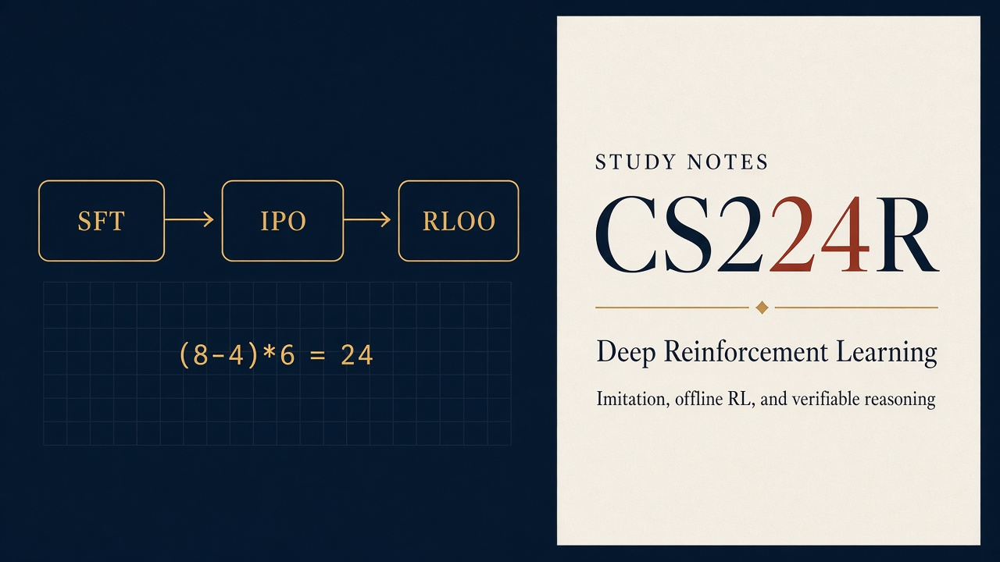
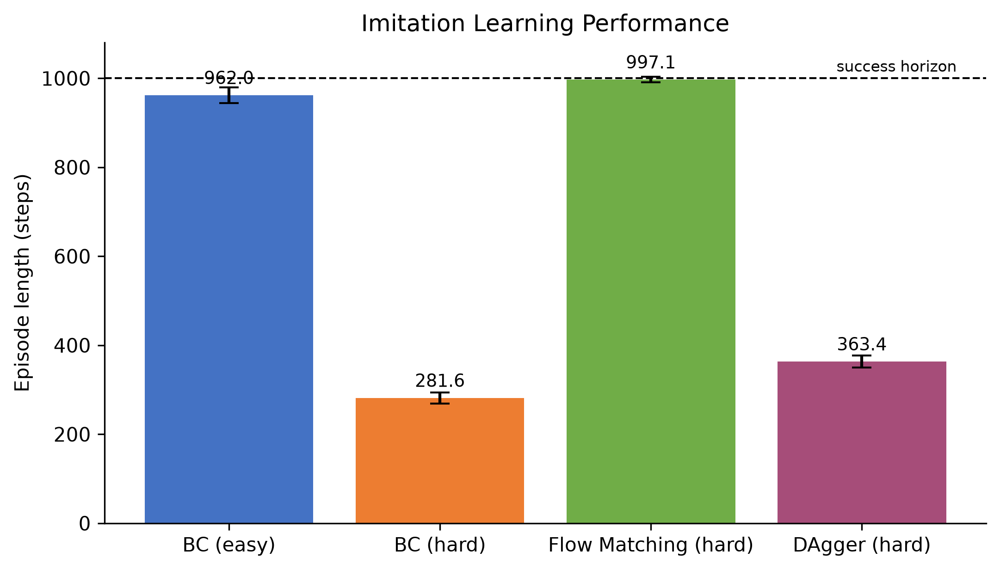
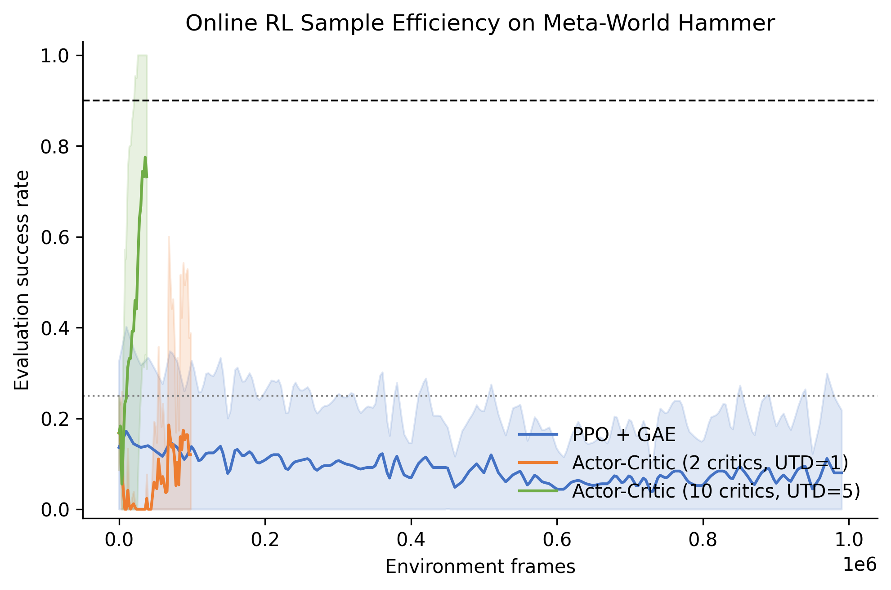
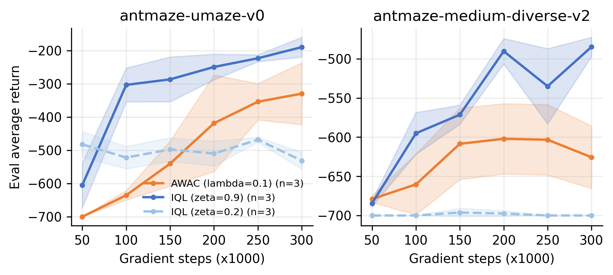
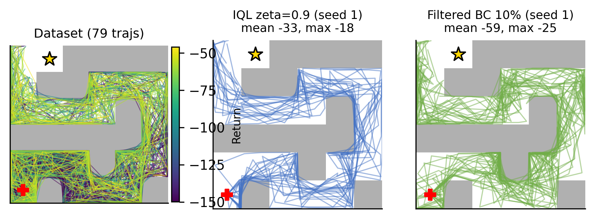
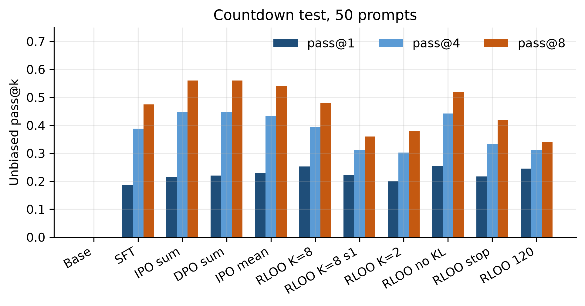
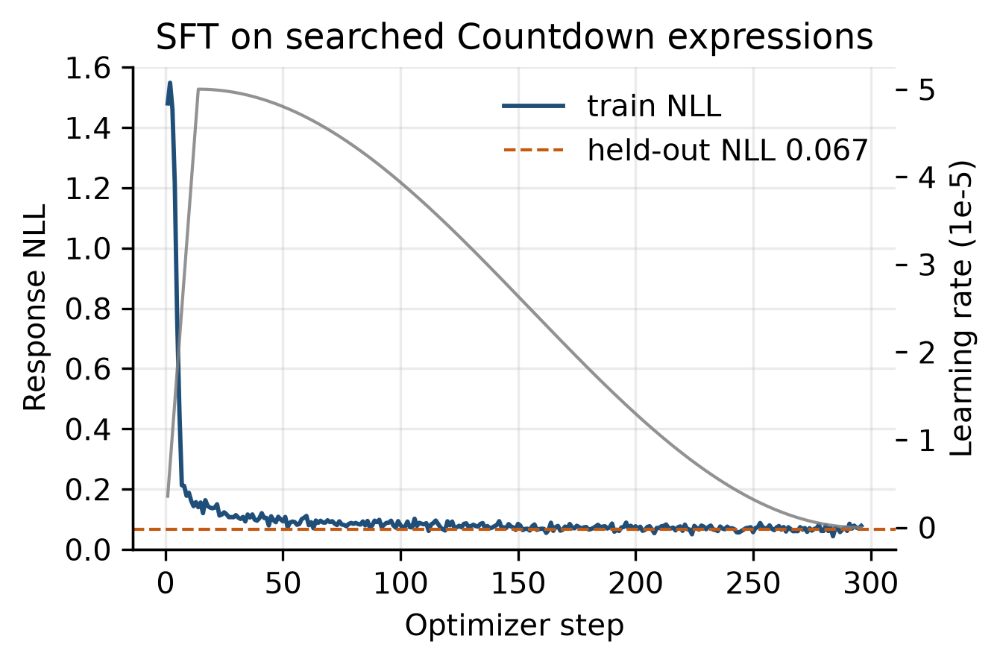
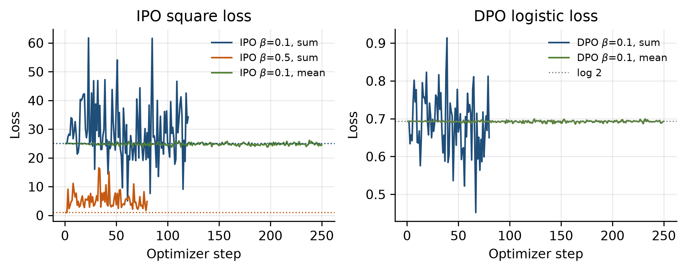
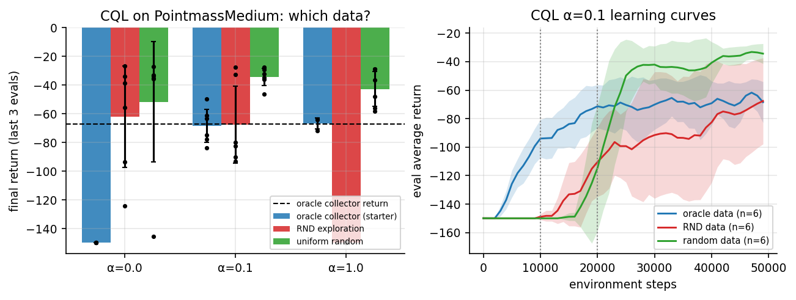
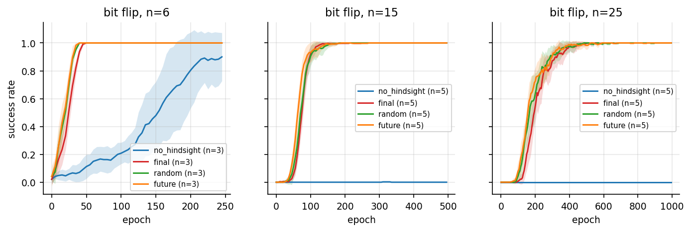

# Stanford CS224R · Deep Reinforcement Learning



> 深度强化学习自学仓库：完整镜像 Stanford CS224R（Spring 2026 / 2025 / 2023）官方讲义、
> 作业 handout 与 starter code，配套 **18 讲中文笔记**、**作业实现指南**、**论文/工具索引** 与
> **可复现实验卡片**。面向「能推导、能比较、能实现」的面试与科研复习方式组织。

> 本项目与 Stanford University 及 CS224R 课程团队无隶属关系。官方材料版权归原作者所有，
> 本仓库仅作个人学习与求职知识整理；`solutions/` 中的个人实现**不应被正在修读的学生参考或提交**，
> 详见 [学术诚信](#引用与学术诚信)。
>
> 面试准备入口：[项目作品集（STAR）](interview/PORTFOLIO.md) ·
> [工程与调试手册](interview/ENGINEERING.md) · [补充题库](interview/QUESTION-BANK.md)。
> 全部测试：`./scripts/run-all-tests.ps1`。

---

## 这个仓库解决什么问题

CS224R 是 Chelsea Finn 开设的深度 RL 课程，特点是**算法覆盖面广**（模仿学习 → 在线 RL →
离线 RL → 奖励学习 → LLM RL → 元学习 → 机器人）且**作业工程量大**（MuJoCo、D4RL、Modal、
W&B、PPO/IQL/RLOO）。本仓库把三件事放在一起：

1. **官方材料离线可用**：三代 slides、全部题面 PDF/LaTeX、starter code（含专家数据与
   D4RL 小数据集），固定上游 commit，见 [UPSTREAM.md](UPSTREAM.md)；
2. **中文笔记把算法串起来**：18 讲每讲含「摘要 + 一页速览卡 + 核心概念 + 关键推导 +
   深入推导 + 实现映射 + 易错点与反例 + 面试追问链 + 自测题」，L02–L17 附完整数学推导，
   公式可直接手推，例如 policy gradient 的 causality 化简、AWR/AWAC 与 IQL 的
   expectile 设计、DPO 的隐式奖励推导、GAE 的递推；
3. **作业可落地**：每份作业给出 TODO 地图、调试顺序、常见 bug 与验收指标，
   `solutions/` 收录作者的完整实现、多种子实验、报告与面试总结（见下文各「完整复现」节）。

---

## 课程知识地图

按 2026 版 17 次授课 + 2025 版补充的 exploration 讲，共 18 讲，归为 8 大模块。

| 模块 | 核心考点 | 讲次 | 对应作业/实验 |
| --- | --- | --- | --- |
| MDP 与模仿学习 | MDP 定义、状态 vs 观测、BC、多模态动作、diffusion/flow matching、action chunking、DAgger | [L1](notes/lecture-01-intro-mdps.md) [L2](notes/lecture-02-imitation-learning.md) | A1 全部 |
| 策略梯度与 Actor-Critic | REINFORCE、reward-to-go、baseline、GAE、MC vs bootstrap、PPO clip、SAC | [L3](notes/lecture-03-policy-gradients.md) [L4](notes/lecture-04-actor-critic.md) [L5](notes/lecture-05-off-policy-actor-critic.md) | A2 P2/P3 |
| 值方法 | Bellman 最优、tabular/DQN、target network、overestimation、Double Q、n-step | [L6](notes/lecture-06-q-learning.md) | A2 P1 |
| 离线 RL | 分布偏移、OOD 动作、AWR、expectile、IQL、CQL、stitching | [L7](notes/lecture-07-offline-rl.md) | A3 全部 |
| 奖励与偏好学习 | goal classifier、偏好排序、Bradley-Terry、RLHF、DPO、reward hacking | [L8](notes/lecture-08-reward-learning.md) [L9](notes/lecture-09-rlhf-preference-optimization.md) | A3、Default Project |
| LLM 推理 RL | CoT、self-consistency、GRPO、RLOO、pass@k、test-time compute | [L10](notes/lecture-10-rl-llm-reasoning.md) | Default Project |
| 模型、任务与元学习 | learned dynamics、MBPO、planning、multi-task、goal-conditioned、HER、RL²、MAML、PEARL | [L11](notes/lecture-11-model-based-rl.md) [L12](notes/lecture-12-multi-task-goal-conditioned-rl.md) [L13](notes/lecture-13-meta-rl.md) [L14](notes/lecture-14-exploration.md) | 期末项目选题 |
| 层次与机器人 | options、语言/图像子目标、高层 DAgger、domain randomization、sim-to-real、VLA RL | [L15](notes/lecture-15-hierarchical-rl-il.md) [L16](notes/lecture-16-sim-to-real.md) [L17](notes/lecture-17-rl-for-vlas.md) [L18](notes/lecture-18-frontiers.md) | 期末项目选题 |

> 2026 版没有第 14 讲（exploration），L14 笔记依据 2025 版整理，属于补课内容。

---

## 核心公式速查

面试与考试中需要能**现场手推**的量。符号：`s` 状态、`o` 观测、`a` 动作、`γ` 折扣、
`ρ` 概率比、`A` 优势、`ζ` expectile、`β/λ` 温度。

| 量 | 公式 | 说明 |
| --- | --- | --- |
| 回报 | `G = Σ_{t=0}^{T} γ^t r_t` | 折扣累积奖励 |
| 策略梯度 | `∇J(θ) = E_{τ~πθ}[Σ_t ∇log πθ(a_t\|s_t) · R_t]` | `R_t` 为 reward-to-go |
| causality 化简 | `E[Σ_t ∇log πθ(a_t\|s_t) · (Σ_{t'<t} r_{t'})] = 0` | 去掉与未来动作无关的项 |
| baseline | `∇J = E[Σ_t ∇log πθ(a_t\|s_t) · (R_t − b(s_t))]` | 任意只依赖状态的 `b` 不引入偏差 |
| 优势 | `A^π(s,a) = Q^π(s,a) − V^π(s)` | 相对基线的度量 |
| 贝尔曼最优 | `Q*(s,a) = r + γ max_{a'} Q*(s',a')` | Q-learning 的更新目标 |
| TD 残差 / GAE | `δ_t = r_t + γV(s_{t+1}) − V(s_t)`；`Â_t = δ_t + γλÂ_{t+1}` | 偏差-方差折中 |
| Q-learning 更新 | `Q(s,a) ← Q(s,a) + α[r + γ max_{a'} Q(s',a') − Q(s,a)]` | off-policy，max 带来过估计 |
| Double Q | `y = r + γ Q_{θ'}(s', argmax_{a'} Q_θ(s',a'))` | 解耦选择与评估 |
| AWR/AWAC | `L_π = −E_D[log π(a\|s) · exp(A(s,a)/λ)]` | advantage 加权模仿 |
| Expectile | `L_2^ζ(µ) = \|ζ − 1{µ≤0}\| µ²` | `ζ>0.5` 时学上分位数 |
| IQL | `L_V = E[L_2^ζ(Q_{\bar θ}(s,a) − V_ψ(s))]`；`L_Q = E[(r + γV_ψ(s') − Q_θ(s,a))²]` | 不查询 OOD 动作 |
| CQL 正则 | `α E_{a~µ}[Q(s,a)] − α E_{a~D}[Q(s,a)]` | 压低 OOD 动作价值 |
| DPO | `L = −E[log σ(β log(π_θ(y_w\|x)/π_ref) − β log(π_θ(y_l\|x)/π_ref))]` | 隐式奖励 `β log(π_θ/π_ref)` |
| GRPO/RLOO 优势 | `Â_i = r_i − mean_{j≠i} r_j`（leave-one-out） | 组内相对优势，无 critic |
| PPO clip | `L = −E[min(ρ_t Â_t, clip(ρ_t,1±ε) Â_t)]` | 多轮复用同一批数据 |
| Flow matching | `a_τ = τa_1 + (1−τ)a_0`；目标 `v = a_1 − a_0` | Euler 积分 `a ← a + v/n` |
| 动作块 | 预测 `T=20` 个动作，执行 `K=10` 后重查 | receding horizon |

完整推导见对应笔记与 [GLOSSARY](notes/GLOSSARY.md)。

---

## 高频问题速查

### 模仿学习与策略梯度（L1–L5）

| 问题 | 答题要点 | 笔记 |
| --- | --- | --- |
| BC 为什么会 compounding error？ | 测试时状态偏离训练分布，误差随步数超线性累积（`O(T²ε)` 直觉） | [L2](notes/lecture-02-imitation-learning.md) |
| 为什么 BC 在 multimodal 数据上会「平均」？ | MSE 对多峰条件分布求均值，产生数据分布外的动作 | [L2](notes/lecture-02-imitation-learning.md) |
| action chunking 为什么有效？ | 减少每步重查带来的误差累积和推理开销；receding horizon 保留反馈 | [L2](notes/lecture-02-imitation-learning.md) |
| flow matching 与 diffusion 的关系？ | 都学从噪声到数据的变换；FM 直接回归速度场，采样用 ODE，更简单 | [L2](notes/lecture-02-imitation-learning.md) |
| DAgger 为什么能修正分布偏移？ | 用当前策略访问的状态 + 专家标注，聚合训练，直接覆盖出错状态 | [L2](notes/lecture-02-imitation-learning.md) |
| REINFORCE 的梯度怎么推？ | `∇log P(τ)` 展开，环境项与动作项分离，环境概率对 θ 的梯度为 0 | [L3](notes/lecture-03-policy-gradients.md) |
| reward-to-go 与 causality 的作用？ | 去掉 t' < t 的奖励项（条件期望为 0），降低方差且无偏 | [L3](notes/lecture-03-policy-gradients.md) |
| baseline 为什么无偏？ | `E_{a~π}[∇log π(a\|s)·b(s)] = b(s)∇Σπ = 0` | [L3](notes/lecture-03-policy-gradients.md) |
| MC vs TD 估计 V？ | MC 无偏高方差；TD 有偏低方差，可在线更新 | [L4](notes/lecture-04-actor-critic.md) |
| GAE 在做什么？ | 指数加权多步 TD 残差；`λ=0` 退化为 TD，`λ=1` 接近 MC | [L4](notes/lecture-04-actor-critic.md) |
| PPO 为什么 clip？ | 限制新旧策略概率比，避免用旧数据做过大更新 | [L5](notes/lecture-05-off-policy-actor-critic.md) |
| SAC 的三个关键组件？ | 最大熵目标、clipped double-Q、reparameterization + 自动温度 | [L5](notes/lecture-05-off-policy-actor-critic.md) |

### 值方法、离线 RL 与奖励（L6–L9）

| 问题 | 答题要点 | 笔记 |
| --- | --- | --- |
| Q-learning 为什么 off-policy？ | 目标是 `max_a Q`，不依赖采样策略的动作分布 | [L6](notes/lecture-06-q-learning.md) |
| 为什么会有 overestimation？ | `max` 作用于带噪估计，`E[max Q̂] ≥ max E[Q̂]` | [L6](notes/lecture-06-q-learning.md) |
| Double Q-learning 的改动？ | 一组网络选动作、另一组评估，打破同一噪声的正相关 | [L6](notes/lecture-06-q-learning.md) |
| 离线 RL 的核心难点？ | 数据分布外动作上 Q 值不可信，bootstrapping 放大误差 | [L7](notes/lecture-07-offline-rl.md) |
| AWR 与 BC 的区别？ | 用 `exp(A/λ)` 加权样本，好动作多模仿、坏动作少模仿 | [L7](notes/lecture-07-offline-rl.md) |
| expectile 为什么有用？ | 非对称 L2 可学习「上分位数」，逼近数据中高回报的 TD 目标 | [L7](notes/lecture-07-offline-rl.md) |
| IQL 与 AWAC 的区别？ | IQL 用 `V(s')` 避免采样 `a'`；critic 只在数据动作上更新 | [L7](notes/lecture-07-offline-rl.md) |
| CQL 在惩罚什么？ | 抬高数据动作 Q、压低 OOD 动作 Q，学习保守下界 | [L7](notes/lecture-07-offline-rl.md) |
| goal classifier 被 exploit 怎么办？ | RL 会钻分类器漏洞；需要负样本挖掘或约束优化 | [L8](notes/lecture-08-reward-learning.md) |
| 偏好数据怎么变成奖励？ | Bradley-Terry 模型 + 交叉熵，学 `R(x,y)` | [L8](notes/lecture-08-reward-learning.md) |
| DPO 为什么不需要 reward model？ | 奖励可写成 `β log(π_θ/π_ref)`，直接对策略做偏好损失 | [L9](notes/lecture-09-rlhf-preference-optimization.md) |
| reward over-optimization？ | proxy reward 上升而真实偏好下降，需 KL/早停 | [L9](notes/lecture-09-rlhf-preference-optimization.md) |

### LLM RL、模型与元学习（L10–L14）

| 问题 | 答题要点 | 笔记 |
| --- | --- | --- |
| GRPO 与 PPO 的差别？ | 去掉 value network，用同 prompt 一组 rollout 的组内归一化做优势 | [L10](notes/lecture-10-rl-llm-reasoning.md) |
| RLOO 的 baseline？ | leave-one-out 均值，`Â_i = r_i − mean_{j≠i} r_j`，无偏且不需 critic | [L10](notes/lecture-10-rl-llm-reasoning.md) |
| 推理模型的 test-time scaling？ | 用更多采样/验证/搜索换准确率；评估应画 score vs compute | [L10](notes/lecture-10-rl-llm-reasoning.md) |
| MBRL 的收益与风险？ | 样本效率高，但模型误差导致分布偏移与 exploitation | [L11](notes/lecture-11-model-based-rl.md) |
| MBPO 为什么要短 rollout？ | 从真实状态出发、限制模型展开长度以控制模型误差累积 | [L11](notes/lecture-11-model-based-rl.md) |
| goal-conditioned 与 multi-task 的关系？ | GCRL 是 `z=s_g` 的特例；统一为条件 MDP | [L12](notes/lecture-12-multi-task-goal-conditioned-rl.md) |
| HER 的核心操作？ | 用实际到达状态重标记 goal，把失败轨迹变成成功数据 | [L12](notes/lecture-12-multi-task-goal-conditioned-rl.md) |
| RL² 与 MAML 的差别？ | RL² 把历史塞进 RNN 隐状态；MAML 学初始化并做几步梯度 | [L13](notes/lecture-13-meta-rl.md) |
| meta-RL 的探索为什么难？ | 需要为「快速识别任务」主动收集信息，探索与执行耦合 | [L13](notes/lecture-13-meta-rl.md) |
| intrinsic reward 的常见形式？ | 计数/伪计数、预测误差（ICM）、随机网络蒸馏（RND）、熵 | [L14](notes/lecture-14-exploration.md) |

### 层次、机器人与前沿（L15–L18）

| 问题 | 答题要点 | 笔记 |
| --- | --- | --- |
| 层次化的三个设计问题？ | 子目标怎么表示、各层怎么监督、何时切换子目标 | [L15](notes/lecture-15-hierarchical-rl-il.md) |
| 高层策略为什么要 DAgger？ | 高层预测的子目标错误会累积，用人工纠正数据重新标注 | [L15](notes/lecture-15-hierarchical-rl-il.md) |
| domain randomization 在干什么？ | 把动力学/感知参数 `e` 随机化，学对分布鲁棒的策略 | [L16](notes/lecture-16-sim-to-real.md) |
| 为什么 PPO 仍是 sim-to-real 主力？ | on-policy 稳定、并行仿真吞吐高、对 reward shaping 容忍度好 | [L16](notes/lecture-16-sim-to-real.md) |
| VLA + RL 为什么难？ | 模型大、梯度贵、真实采样昂贵、稀疏奖励；IL 常卡在 80% 左右 | [L17](notes/lecture-17-rl-for-vlas.md) |
| 离线 RL 微调 VLA 的配方？ | 监督学 V（MC）+ advantage-conditioned 行为克隆，避免 OOD | [L17](notes/lecture-17-rl-for-vlas.md) |
| 在线 RL 微调 VLA 的轻量方案？ | 冻结 VLA，学小策略编辑噪声/动作残差 | [L17](notes/lecture-17-rl-for-vlas.md) |
| 怎么开始做 RL 研究？ | 复现 baseline → 单变量消融 → 明确 claim → 严谨评测（见 L18） | [L18](notes/lecture-18-frontiers.md) |

---

## 学习路线

| 阶段 | 主题 | 材料 | 产出 |
| --- | --- | --- | --- |
| 0 | 数学与 RL 基础 | Sutton & Barto Ch.3–4、CS221 MDP module | 能写 Bellman 方程 |
| 1 | 模仿学习 | L1–L2 + A1 | Flappy Bird BC/FM/DAgger |
| 2 | 在线 RL | L3–L6 + A2 | PPO ≥25%、AC ≥90% |
| 3 | 离线 RL | L7–L8 + A3 | AWAC/IQL + stitching 分析 |
| 4 | LLM RL | L9–L10 + Default Project | SFT → IPO → RLOO + pass@k |
| 5 | 进阶与科研 | L11–L18 + 期末项目 | 一个可复现的研究问题 |

**考试速览路线（期中前 2 小时）**：L3 策略梯度推导 → L4 GAE → L5 PPO clip →
L6 Double Q → L7 IQL 三件套 → L8 偏好奖励 → L12 HER → L13 元学习流程图。

---

## 课程材料总览

### Slides

| 版本 | 目录 | 数量 | 备注 |
| --- | --- | --- | --- |
| Spring 2026 | [`slides/spring2026/`](slides/spring2026/) | 17 | 当前版；无 exploration（14） |
| Spring 2025 | [`slides/spring2025/`](slides/spring2025/) | 19 | 有完整录像，含 Q-learning section |
| Spring 2023 | [`slides/spring2023/`](slides/spring2023/) | 19 | 含 practical deep RL、skill discovery |

### 视频（Spring 2025，官方 YouTube）

- [完整播放列表](https://www.youtube.com/playlist?list=PLoROMvodv4rPwxE0ONYRa_itZFdaKCylL)
  （18 讲 + Q-learning tutorial；每一讲的直链见 `slides/README.md` 与各笔记）

### 其他官方材料

- [`materials/spring2026/`](materials/spring2026/)：compute guide、exam review pptx、
  Q-learning section、期末项目索引；
- [`materials/spring2025/`](materials/spring2025/)：2025 届项目索引。

---

## 作业概览

### Spring 2026（当前版，3 次作业 + 期中 + 项目）

| 作业 | 主题 | 关键实现 | 入口 |
| --- | --- | --- | --- |
| Homework 1 (10%) | Imitation Learning（Flappy Bird + action chunking） | BC 回归、flow matching、DAgger | [`assignments/spring2026/homework1-imitation`](assignments/spring2026/homework1-imitation/) |
| Homework 2 (15%) | Online RL（gridworld + Sawyer hammer） | 表格 Q-learning、PPO+GAE、off-policy AC（critic ensemble + BC 预训练 + UTD） | [`assignments/spring2026/homework2-online-rl`](assignments/spring2026/homework2-online-rl/) |
| Homework 3 (15%) | Offline RL（D4RL Antmaze + PointMass） | AWAC、IQL、expectile、stitching | [`assignments/spring2026/homework3-offline-rl`](assignments/spring2026/homework3-offline-rl/) |
| Default Project (35%) | Countdown 推理任务 | SFT、IPO、RLOO、pass@k | [`assignments/spring2026/default-project`](assignments/spring2026/default-project/) |

每份作业目录内都有我写的 `README.md`：TODO 地图、实现顺序、调试清单与验收标准。

### 历史版本（存档）

- [`assignments/spring2025/`](assignments/spring2025/)：4 次作业 —— BC/DAgger（MuJoCo）、
  MJPC 奖励设计 + 在线 RL、IQL/CQL 离线 RL、Goal-conditioned + Meta-RL；
- [`assignments/spring2023/`](assignments/spring2023/)：4 次作业，结构与 2025 基本一致。

---

## 仓库结构

```text
assignments/                 # 三代官方作业：题面 + LaTeX 模板 + starter code
  spring2026/                #   HW1 Flappy Bird、HW2 online RL、HW3 offline RL、default project
  spring2025/                #   HW1–HW4（含 HW3 updated 与 v1 两版）
  spring2023/                #   HW1–HW4 + 项目指南
slides/                      # 三代官方 slides（2026/2025/2023）
materials/                   # compute guide、exam review、TA section、项目索引
notes/                       # 18 讲原创中文笔记 + 术语表 + 阅读路线
experiments/                 # 官方题目索引、论文/工具导读、社区资料、实验卡片
resources/                   # 官方/社区资源索引与版本差异
solutions/                   # 个人实现：2026 HW1–HW3 + Default Project，2025 HW3–HW4
interview/                   # STAR 作品集、工程调试手册、补充题库
templates/                   # 笔记、作业 writeup、实验记录模板
scripts/                     # 材料同步、完整性检查、run-all-tests.ps1
PROGRESS.md                  # 学习进度
UPSTREAM.md                  # 官方快照来源、commit、版权说明
VERIFICATION.md              # 材料完整性核对
```

---

## 快速开始

```powershell
# 1. 读课程与版本说明
#    resources/official.md + resources/versions.md

# 2. 从 L1 开始看笔记，对照 slides/spring2026 或 2025 视频
#    notes/README.md

# 3. 做作业：进入对应目录读我写的 README，再自己填 TODO
#    assignments/spring2026/homework1-imitation/README.md

# 4. 自己的实现在 solutions/ 下建立同名目录，不要直接改 starter-code/
```

本地环境建议：

```bash
# HW1（2026 版，CPU 可跑 Flappy Bird）
cd assignments/spring2026/homework1-imitation/starter-code
pip install -e .
python main.py --method bc_reg --env easy

# HW2 / HW3 / Default Project 官方推荐在 Modal 上跑，需 W&B 账号
pip install modal wandb && modal setup
```

官方 2026 版**不保证**本地 GPU 支持（HW2/HW3 要求 Modal），本地只建议开发调试；
受限环境下的替代方案见 [resources/tools.md](resources/tools.md)。

## Homework 1 完整复现

Spring 2026 Homework 1 已在独立 solution workspace 中完成：

- [实现与复现说明](solutions/spring2026/homework1-imitation/README.md)
- [BC、Flow Matching 与 DAgger 代码](solutions/spring2026/homework1-imitation/code/)
- [单元测试](solutions/spring2026/homework1-imitation/code/tests/)
- [原始指标与实验图](solutions/spring2026/homework1-imitation/artifacts/)
- [作业学术报告（PDF）](solutions/spring2026/homework1-imitation/reports/assignment_report/main.pdf)
- [面试知识总结（PDF）](solutions/spring2026/homework1-imitation/reports/interview_guide/main.pdf)

实验在 NVIDIA RTX 6000D 上运行 5 个独立随机种子。每个方法、每个 seed 使用 50 个
episode 评估，并额外报告 Flow Matching 的 Euler steps 质量--时延消融、action chunk
重规划频率消融、DAgger 逐轮曲线、训练收敛与 expert action 多峰分布。所有报告数字与
图片由逐 seed JSON/NPZ 原始指标生成，不手工录入。



该目录包含个人作业实现，仅用于自学与求职知识整理。正在修读课程的学习者应遵守课程
honor code，不应直接使用或公开提交其中的 solution。

## Homework 2 完整复现

Spring 2026 Homework 2 的实现与实验位于：

- [实现与复现说明](solutions/spring2026/homework2-online-rl/README.md)
- [Q-learning、PPO 与 Actor-Critic 代码](solutions/spring2026/homework2-online-rl/code/)
- [原始指标与实验图](solutions/spring2026/homework2-online-rl/artifacts/)
- [作业学术报告（PDF）](solutions/spring2026/homework2-online-rl/reports/assignment_report/main.pdf)
- [Online RL 面试知识总结（PDF）](solutions/spring2026/homework2-online-rl/reports/interview_guide/main.pdf)

实验在 Meta-World hammer 稀疏奖励任务上比较 PPO、2-critic/UTD=1 actor-critic 与
10-critic/UTD=5 actor-critic，并包含 GAE lambda、Gridworld reward design、样本效率、
跨 seed 稳定性和资源利用率分析。所有曲线由本地 CSV 原始指标生成。



## Homework 3 完整复现

Spring 2026 Homework 3 的实现与实验位于：

- [实现与复现说明](solutions/spring2026/homework3-offline-rl/README.md)
- [AWAC 与 IQL 代码](solutions/spring2026/homework3-offline-rl/code/)
- [原始指标与实验图](solutions/spring2026/homework3-offline-rl/artifacts/)
- [作业学术报告（PDF）](solutions/spring2026/homework3-offline-rl/reports/assignment_report/main.pdf)
- [Offline RL 面试知识总结（PDF）](solutions/spring2026/homework3-offline-rl/reports/interview_guide/main.pdf)

实验比较 AWAC 与 IQL 在 D4RL AntMaze 上的三种子评估，并在 PointMass 拼接数据集上
对照 IQL 与 Filtered BC。u-maze 上 `ζ=0.9` 优于 `ζ=0.2`，medium 沿用 0.9。
IQL 在两张迷宫上的最终回报都高于 `λ=0.1` 的 AWAC。拼接任务中 IQL 的平均回报
高于数据集最大值 -46，Filtered BC（top 10%）的平均回报低于 -46。
medium 使用修复后的 `antmaze-medium-diverse-v2`，因为公开的 v0 HDF5 被截断。
所有曲线由逐 seed `metrics.csv` 生成。





## Default Project 完整复现

Spring 2026 Default Project 在 Countdown 上走完 SFT、IPO/DPO 和 RLOO，并用无偏 pass@k
比较检查点。实现与实验位于：

- [实现与复现说明](solutions/spring2026/default-project/README.md)
- [训练与评估代码](solutions/spring2026/default-project/code/)
- [原始指标与实验图](solutions/spring2026/default-project/artifacts/)
- [作业学术报告（PDF）](solutions/spring2026/default-project/reports/assignment_report/main.pdf)
- [推理后训练面试知识总结（PDF）](solutions/spring2026/default-project/reports/interview_guide/main.pdf)

基座 Qwen2.5-0.5B 在 50 道测试题上的 pass@k 为 0。搜索等式上的一轮 SFT 把 pass@1 抬到 0.188，
留出负对数似然为 0.067。$\beta=0.1$ 的 IPO 在参考策略处损失为 25，与 $(1/(2\beta))^2$ 一致；
序列对数概率求和的版本随后不稳定，长度平均把损失维持在恒等式附近，偏好准确率仍约 0.5。
RLOO 的两个种子和 120 步修正运行都没有在 pass@8 上稳定超过 SFT。
曲线由 `metrics.jsonl` 与 pass@k JSON 生成。







该目录包含个人作业实现，仅用于自学与求职知识整理。正在修读课程的学习者应遵守课程
honor code，不应直接使用或公开提交其中的 solution。

## Spring 2025 HW3 / HW4 完整复现

2026 版没有 CQL、HER 与 meta-RL，因此补做 2025 版的这两份作业：

- [HW3 IQL / CQL + 探索数据](solutions/spring2025/homework3-offline-rl/README.md)：
  发现 starter 的 CQL 数据采集器其实是 oracle，新增 `--behavior explore` 后，
  IQL 偏好 RND 数据（−50.9 vs −90.7），CQL 偏好随机数据（α=0.1 时 −34.3±6.1）；
- [HW4 HER + RL² vs DREAM](solutions/spring2025/homework4-goal-meta-rl/README.md)：
  HER 把 25-bit flip 从 0 提到 1.0，Sawyer 从 0.547 提到 0.994；DREAM 0.696 接近最优 0.7，
  RL² 只有 0.143。





---

## 引用与学术诚信

- 官方材料按其原始版权保留，来源固定记录在 [UPSTREAM.md](UPSTREAM.md)；
- 第三方笔记与实现只在 `resources/` 中链接，不复制内容；
- `solutions/` 是作者在修完/旁听后完成的个人实现，用于求职展示，不是课程提交；
- CS224R honor code：禁止参考答案、禁止公开自己的作业解答。如果你正在修读该课，
  请勿公开推送 `solutions/`，也请勿把本仓库笔记当作提交材料；
- 每一讲笔记末尾标注了参考的官方材料与论文，引用任何思路时请注明来源。

---

## License

原创笔记、索引与脚本采用 [MIT License](LICENSE)。官方材料继续适用其各自版权；
本项目仅作个人学习使用，不用于商业分发。
