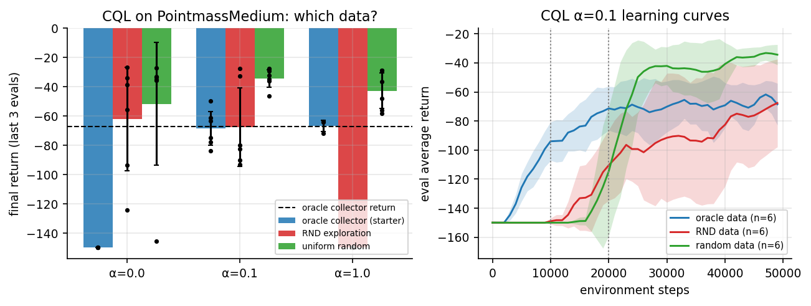
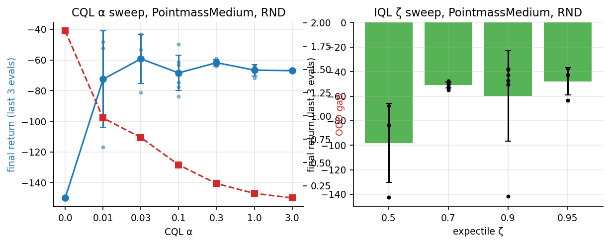
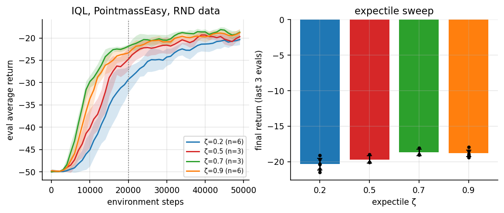
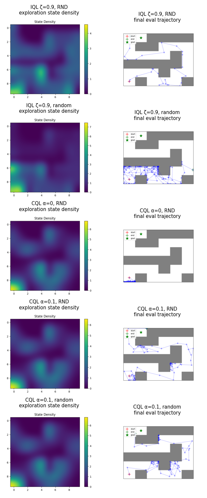

# 2025 HW3 完整实现：IQL / CQL 与探索数据

本目录是 CS224R Spring 2025 Homework 3（updated 版）的 solution workspace：在 PointMass
迷宫上先用 RND 或随机探索收集数据，再用 IQL / CQL 学习。官方 starter 在
`assignments/spring2025/` 下，不修改。

作者：ShaneLiu04（[GitHub](https://github.com/ShaneLiu04)）

## 完成内容

- IQL：expectile 价值损失、`r + γV(s')` 的 Q 目标、advantage-weighted 策略提取。
- CQL：离散动作的 `logsumexp_a Q(s,a) − Q(s,a_data)` 保守正则，α 扫描与 OOD gap 记录。
- RND：随机目标网络蒸馏误差作为探索奖励。
- **starter 发现**：`explore_or_exploit_agent.step_env` 无论 `--use_rnd` 如何都调用
  `env.get_optimal_action`（全源最短路上的贪心，即专家），开关只改变 `learning_starts`。
  新增 `run_cql.py --behavior {oracle,explore}`，默认 `oracle` 保持原行为；`explore`
  按 RND / ε-随机策略真实采集。另用 `analysis/oracle_baseline.py` 评估 oracle 本身。
- 单元测试 `tests/test_iql_cql.py`。
- 两份报告：[作业报告（PDF）](reports/assignment_report/main.pdf) 与
  [面试知识总结（PDF）](reports/interview_guide/main.pdf)（中文，保留英文术语）。

## 主要结果

Easy / Medium / Hard 的回合上限分别为 50 / 150 / 100 步，Medium 上 −150 表示失败。
括号内为种子数。

| 设置 | 回报 |
| --- | --- |
| IQL Easy ζ=0.2 / 0.9 | −20.36±0.81 (6) / −18.84±0.48 (6) |
| IQL Medium ζ=0.7，RND 数据 / 随机数据 | −50.85±2.43 / −90.69±6.72 |
| IQL Hard ζ=0.9 | −93.3±3.8 |
| CQL Medium，oracle 数据，α=0 | −150（全部种子失败） |
| CQL Medium，oracle 数据，α=0.1 | −68.5±11.5 |
| CQL Medium，探索数据 α=0.1：RND / 随机 | −67.6±26.9 / −34.3±6.1 (6) |
| CQL Medium，RND 数据 α=1 | −150 |
| CQL Hard，α=0 / 0.1 | −100 / −41.1±2.0 |

结论：oracle 数据下任何 α>0 都能解 Medium，OOD gap 随 α 从 1.91 降到 0.12；
真实探索数据下 IQL 偏好 RND 数据，CQL 偏好随机数据，RND 数据加强保守正则会失败。









## 复现

```bash
cd solutions/spring2025/homework3-offline-rl/code
# IQL：20k 步探索后继续以 ε=0.2 加数据（offline-to-online）
PYTHONPATH=. python cs224r/scripts/run_iql.py --env_name PointmassMedium-v0 \
  --num_exploration_steps=20000 --unsupervised_exploration --awac_lambda=1 \
  --use_rnd --iql_expectile=0.7 --seed 0 --exp_name iql_medium_z0.7_rnd_s0
# CQL：10k 步探索后严格离线；--behavior explore 才使用真实探索数据
PYTHONPATH=. python cs224r/scripts/run_cql.py --env_name PointmassMedium-v0 \
  --unsupervised_exploration --offline_exploitation --behavior explore \
  --cql_alpha=0.1 --seed 0 --exp_name cql_medium_a0.1_random_s0
# 测试
cd .. && python -m pytest -q tests
```

图与结果宏由 `../analysis/collect_scalars.py` 汇总 TensorBoard 标量，再由
`../analysis/plot_2025.py` 生成（原始数据在 `../analysis/raw/`）。

## 目录

```text
homework3-offline-rl/
├── code/                 # starter 副本 + IQL/CQL/RND 实现
├── tests/test_iql_cql.py
├── artifacts/figures/    # hw3_fig1..8（PNG + PDF）
└── reports/
    ├── assignment_report/
    ├── interview_guide/
    └── references.bib
```

## 学术诚信

仅用于个人学习与求职知识整理。正在修读课程的学习者应遵守 honor code。
