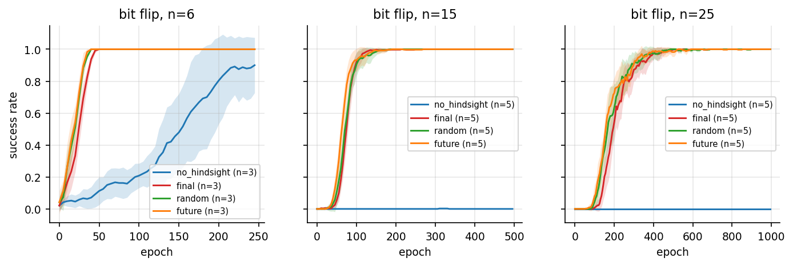
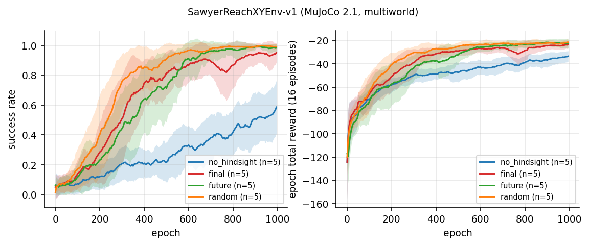
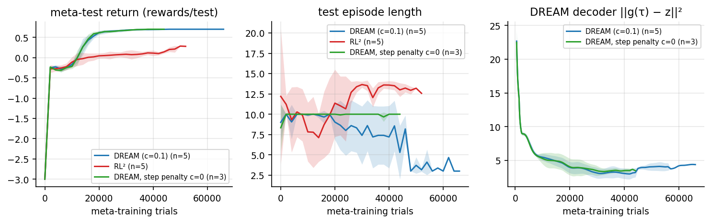
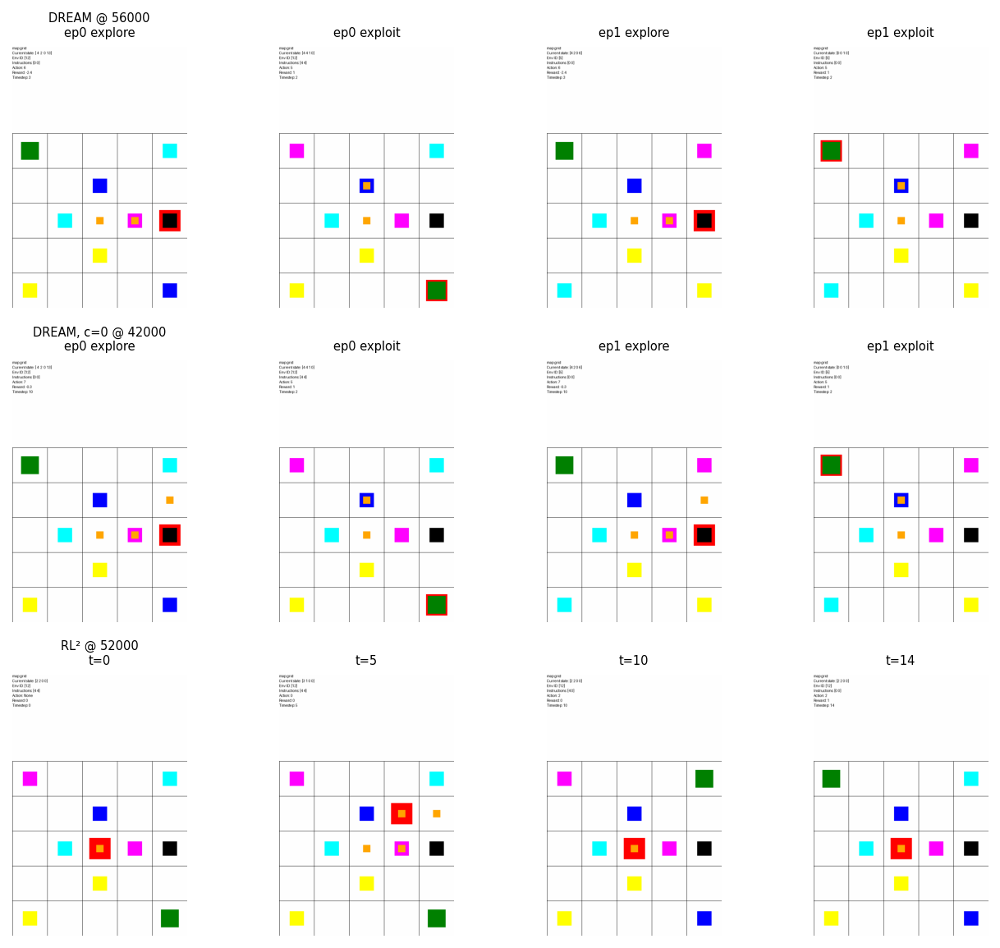

# 2025 HW4 完整实现：HER 与 Meta-RL（RL² vs DREAM）

本目录是 CS224R Spring 2025 Homework 4 的 solution workspace：goal-conditioned DQN 上的
Hindsight Experience Replay（bit-flip 与 Sawyer reach），以及网格 meta-RL 上 RL² 与 DREAM
的对比。官方 starter 在 `assignments/spring2025/` 下，不修改。

作者：ShaneLiu04（[GitHub](https://github.com/ShaneLiu04)）

## 完成内容

- HER 重标记：final / future / random 三种策略，每条 transition 额外写入 k 条重标记样本。
- Goal-conditioned DQN：目标网络，目标值裁剪到 `[−1/(1−γ), 0]`，γ=0.98。
- DREAM：探索轨迹解码器（带 stop-gradient 的掩码 MSE），信息增益探索奖励减每步代价 c
  （默认 0.1），以及 c=0 消融。
- 单元测试 `tests/test_her_dream.py`：重标记、解码器损失、信息增益奖励。
- [作业报告（PDF，含 Problem 0 回答）](reports/assignment_report/main.pdf)、
  [面试知识总结（PDF）](reports/interview_guide/main.pdf) 与 meta-RL 最终帧可视化。

## 主要结果

| 设置 | 结果 |
| --- | --- |
| bit-flip 6 bit 无 hindsight | 0.896±0.143 |
| bit-flip 15 / 25 bit 无 hindsight | 0 / 0 |
| bit-flip 所有 HER 变体 | 最终 1.0；25 bit 到 0.9 需 290–320 epoch |
| HER k ∈ {1,2,4,8}（15 bit） | 无差别（90–95 epoch 到 0.9） |
| Sawyer：无 hindsight / final / future / random（5 seeds） | 0.547±0.106 / 0.946±0.045 / 0.986±0.011 / 0.994±0.006 |
| Meta-RL：DREAM / RL²（5 seeds） | 0.696±0.007 / 0.143±0.073 |
| DREAM c=0（3 seeds） | 0.70，探索长度 9.9±0.16 |

网格上走路回报 0.1，读地图后坐公交的最优回报 0.7。DREAM 接近最优；RL² 基本只学会走路。
c 不影响能否学会，只影响探索效率。









## 复现

```bash
cd solutions/spring2025/homework4-goal-meta-rl/code/goal_conditioned_rl
python main.py --env bit_flip --num_bits 25 --num_epochs 1000 --her_type future --random_seed 0 \
  --log_dir runs/bit_flip/bits25/future/s0
python main.py --env sawyer_reach --num_epochs 1000 --her_type random --random_seed 0 \
  --log_dir runs/sawyer_reach/random/s0

cd ../meta_rl
PYTHONPATH=. python scripts/dream.py dream_s0 -b 'environment="map"' -s 0 -x runs/meta -f
PYTHONPATH=. python scripts/rl2.py rl2_s0 -b 'environment="map"' -s 0 -x runs/meta -f

cd ../.. && python -m pytest -q tests
```

## 目录

```text
homework4-goal-meta-rl/
├── code/goal_conditioned_rl/   # bit-flip、Sawyer、HER、DQN
├── code/meta_rl/               # RL²、DREAM、网格环境
├── tests/test_her_dream.py
├── artifacts/figures/          # hw4_fig1..6（PNG + PDF）
└── reports/
    ├── assignment_report/
    ├── interview_guide/
    └── references.bib
```

## 学术诚信

仅用于个人学习与求职知识整理。正在修读课程的学习者应遵守 honor code。
