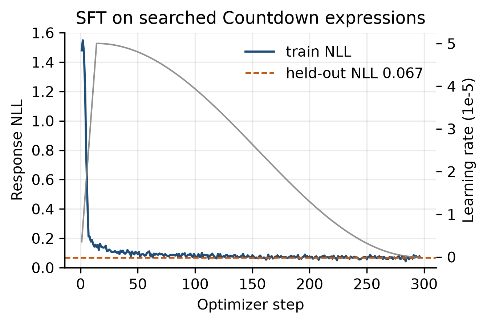
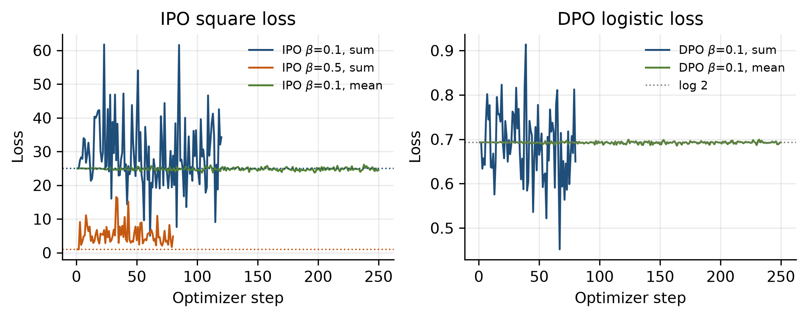
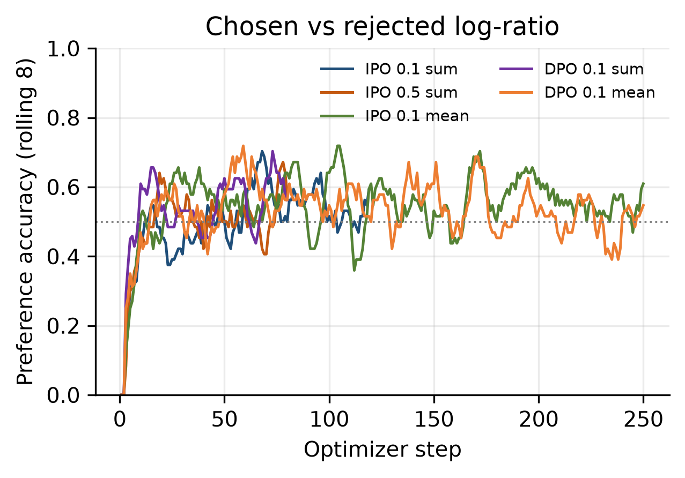
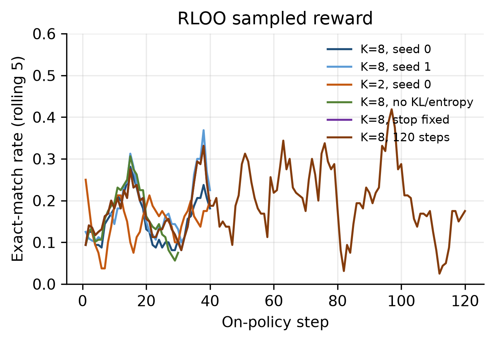
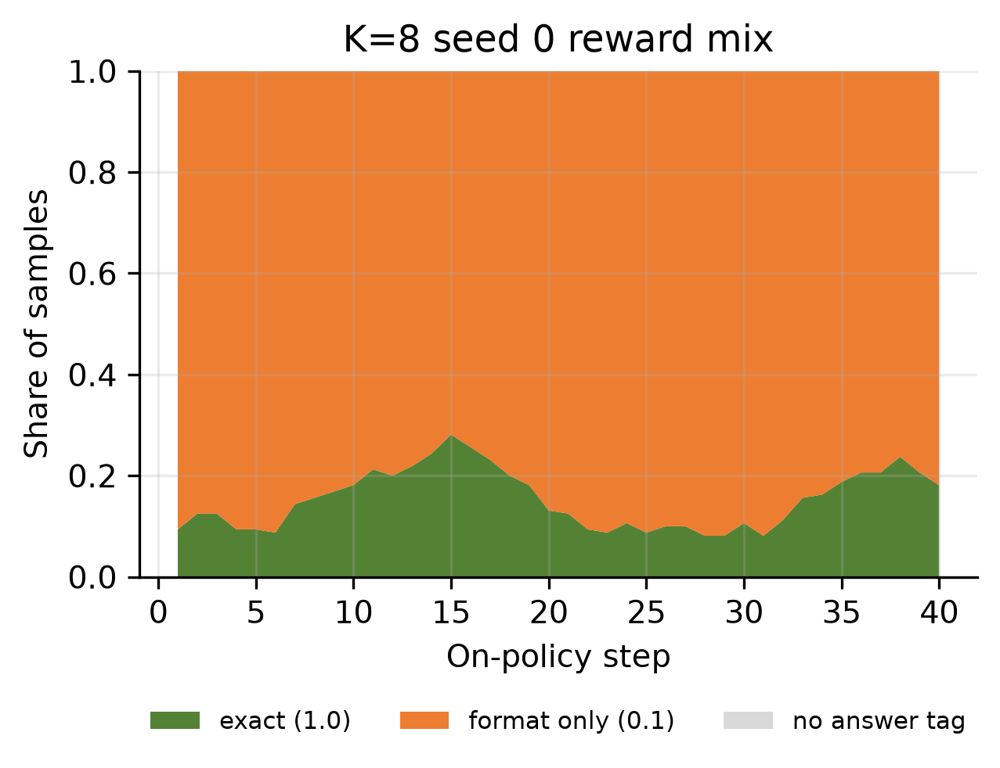
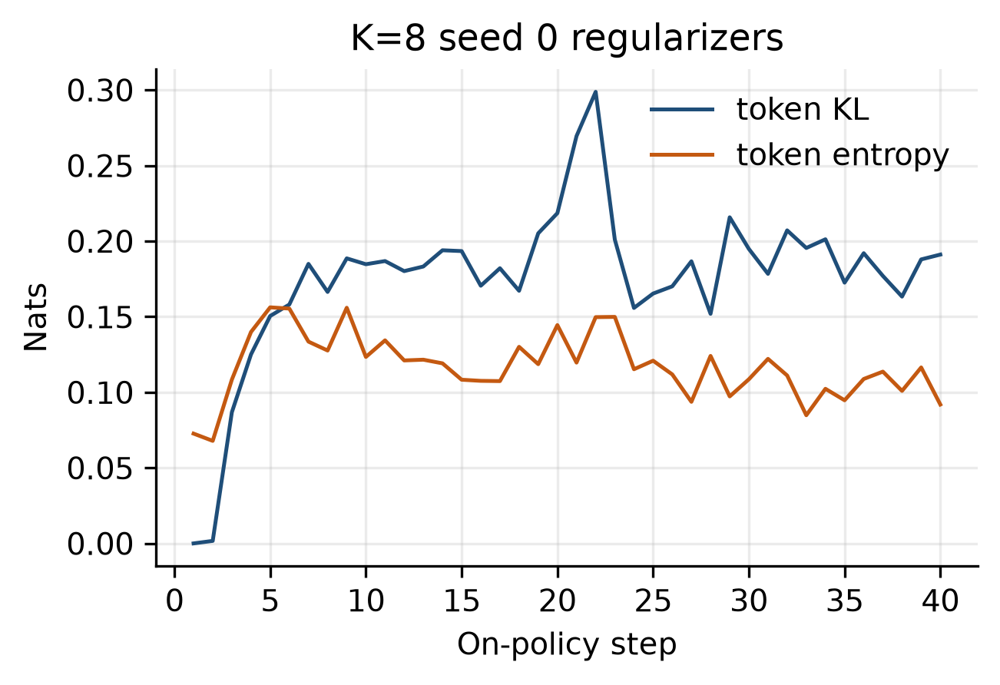
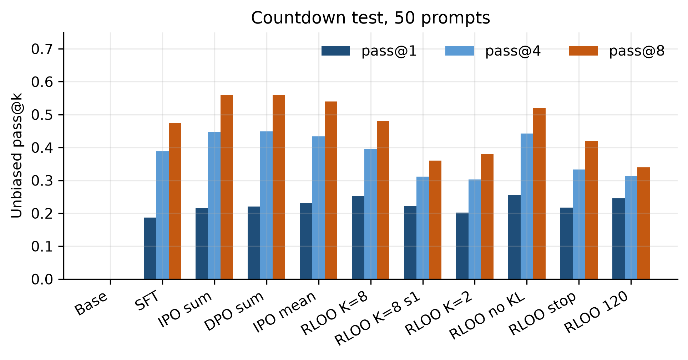
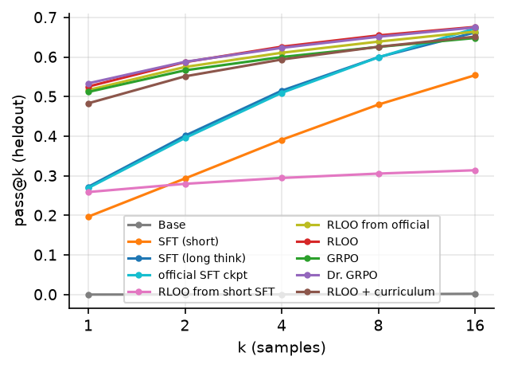
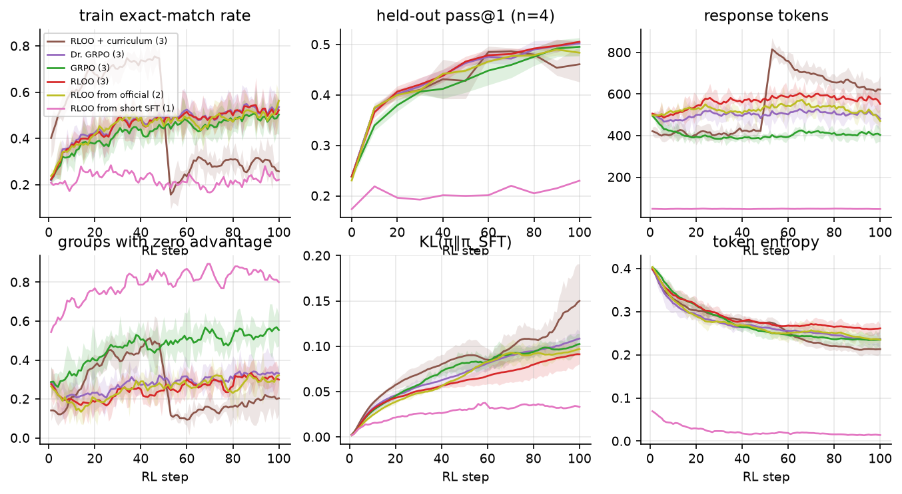

# Default Project 完整实现：Countdown 推理后训练

本目录是 CS224R Spring 2026 Default Project 的 solution workspace。官方 starter code 在
`assignments/spring2026/default-project/starter-code/`，这里不修改它。个人实现、测试、
原始指标、图和两份中文报告集中在本目录。

作者：ShaneLiu04（[GitHub](https://github.com/ShaneLiu04)）

## 完成内容

- SFT：只在回答 token 上计算因果语言模型负对数似然，掩码右移一位。
- IPO / DPO：冻结的参考模型上计算 $\Delta=\log\pi_\theta-\log\pi_{\mathrm{ref}}$。
  IPO 为 $(\Delta_w-\Delta_l-1/(2\beta))^2$，DPO 为 $-\log\sigma(\beta(\Delta_w-\Delta_l))$。
  $\Delta$ 可以是序列求和或长度平均。
- RLOO：组内 leave-one-out 优势，on-policy 重要性权重为 1，可选 token 熵和 KL。
- 7 个单元测试：掩码、提示不参与反传、参考策略上的 IPO 恒等式、大间隔时 DPO 趋近 0、
  RLOO 优势、序列对数概率的和与平均、均匀分布的熵与零 KL。
- 进程内 Hugging Face 采样。目标函数与课程里的 Ray worker 相同。Blackwell 上未使用 vLLM。
- Countdown 测试集 50 题的无偏 pass@k。测试题不进入训练。

## 实验事实

基座 Qwen2.5-0.5B 的 pass@1、pass@4、pass@8 都是 0。搜索器在 20,000 条训练提示上
全部找到用恰好给定数字构成的等式，其中 19,000 条做 SFT，1,000 条留出。
一个 epoch、296 步之后，训练负对数似然从 1.480 降到 0.078，留出值 0.067。
SFT 的 pass@1 是 0.188（每个提示 16 条样本）。

$\beta=0.1$ 的 IPO 第一步损失是 25，等于 $(1/(2\beta))^2$。求和版本的验证损失升到 31.07，
偏好准确率 0.500。长度平均把验证损失维持在 25.01。DPO 第一步损失是 0.693，即 $\log 2$。

RLOO 从 SFT 检查点出发，每步 4 个提示。$K=8$ 两个种子的 pass@1 是 0.253 和 0.223，
pass@8 是 0.480 和 0.360。$K=2$ 的 pass@8 是 0.380。修正 `</answer>` 的两种 BPE 之后，
40 步的 pass@8 是 0.420，120 步是 0.340，都没有稳定超过 SFT 的 pass@8。
这些数字由 `analysis/plot_results.py` 从 `artifacts/raw` 写出，报告通过宏引用它们。

第一批 RLOO 的停止序列漏掉了带前导空格的 token，生成会越过答案标签。
修正运行同时接受两种切分，并在闭合标签处截断损失。

## 目录

```text
default-project/
├── code/                    # SFT、IPO、RLOO 与进程内采样
├── tests/test_objectives.py
├── analysis/plot_results.py # 读 raw 指标，写图和 results_macros.tex
├── artifacts/
│   ├── raw/                 # metrics.jsonl 与 pass@k JSON
│   └── figures/             # 报告用 PNG/PDF
└── reports/
    ├── assignment_report/   # 作业报告
    ├── interview_guide/     # 面试知识总结
    ├── references.bib
    └── results_macros.tex
```

## 图

SFT 把回答负对数似然压到留出值附近。这是格式学习，不是解题搜索。



IPO 的点线是参考策略处的恒等式。求和版本离开这条线，长度平均版本贴着它。



偏好准确率停留在 0.5 附近。损失下降不能单独当成对齐已经完成。



在线精确匹配率在 0.05 到 0.4 之间波动。120 步的曲线没有单调上升。



SFT 之后几乎每条样本都有答案标签。绿色部分才是等式算对的比例。





测试集 pass@k。Base 三项为 0。短程偏好优化和 RLOO 的差别小于两个种子之间的差别。



## 扩展：长 think SFT、RLOO / GRPO / Dr. GRPO

留出集 500 题、每题 16 条样本。长 think SFT 的 pass@1 是 0.272，pass@16 是 0.662。
从它出发的长程 RL 把 pass@1 抬到 0.52–0.54，pass@16 仍在 0.64–0.71，和 SFT 的 0.662 同一量级。
Dr. GRPO 的 pass@1 是 0.534±0.008（3 个种子）。短等式 SFT 上的 RLOO 停在 0.259，pass@16 只有 0.314。

原始评测、训练指标和图在 `artifacts/extension/`。长度分布图没有放进来，因为逐条样本文件太大，没有同步。





24×36 英寸海报在 `reports/poster/main.pdf`。它回答课程海报的四个问题：任务、为什么值得做、实验结论、能带走什么以及不能外推的地方。数字和作业报告、面试指南一样，来自 `artifacts/extension/extension_macros.tex`。

## 本地测试

```bash
cd solutions/spring2026/default-project
python -m pytest -q tests   # 目标函数、RL 项（优势/KL/熵）、样本选择，共 16 个测试，CPU 即可
```

## 复现实验时会碰到的点

- 提示若已经含有 chat 模板，SFT 必须关掉第二次套用。偏好数据的 `query` 还没有模板，那里要套。
- `gradient_clipping=0` 表示不调用裁剪。把裁剪范数设成 0 会把梯度清零。
- `</answer>` 的 BPE 取决于前面有没有空格。停止符要用模型实际生成的 token 编号核对。
- 词表上的 log-sum-exp 用 float32 并按时间分块。训练态注意力使用 scaled dot-product，
  否则 `[B,H,T,T]` 会占满显存。
- 调度步数在设置了 `max_steps` 时按这个上限计算，否则短跑会停在按全数据估计的 warmup 里。
