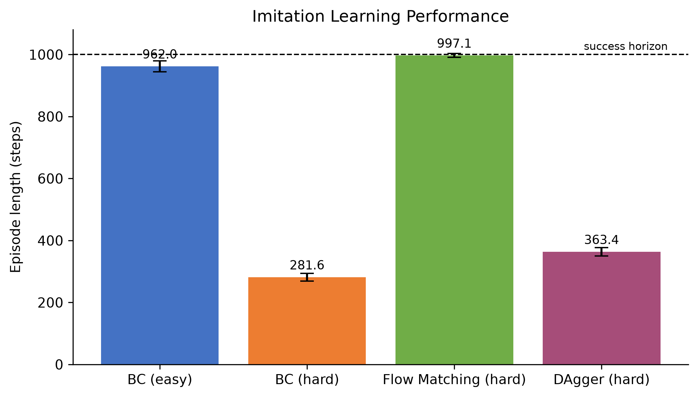
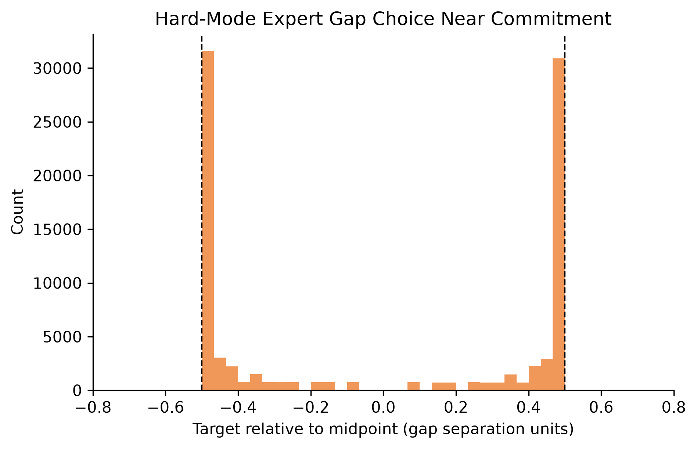
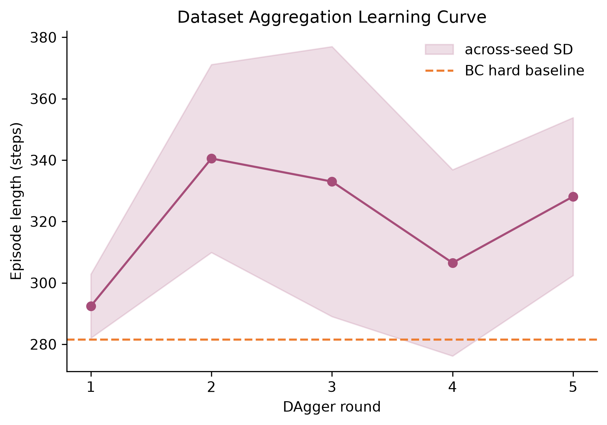
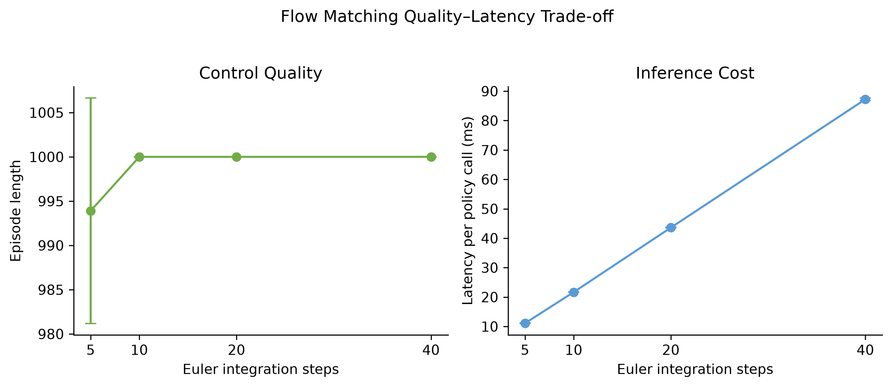
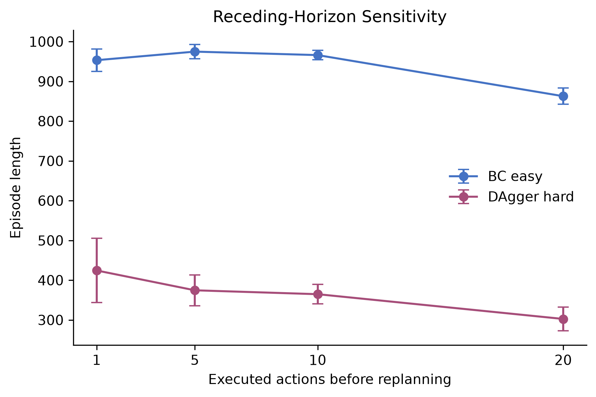

# HW1 完整实现：Imitation Learning

本目录是 CS224R Spring 2026 Homework 1 的独立 solution workspace。官方
starter code 保持不变；实现、测试、原始指标、绘图程序和报告全部放在这里，便于核对
学术材料与个人实现之间的边界。

作者：ShaneLiu04（[GitHub](https://github.com/ShaneLiu04)）

## 完成内容

- `BCPolicy`：三层 MLP、ReLU hidden layers、Sigmoid action head；
- `mse_loss`：action chunk 上的 Behavior Cloning 均方误差；
- `FlowMatchingSchedule`：Conditional OT interpolation 与 Euler ODE sampler；
- `flow_matching_loss`：条件 velocity field 的回归目标；
- `DeterministicExpert`、policy rollout、window relabel 与 DAgger aggregation；
- 6 个单元测试，覆盖 shape、梯度、数值、端点、专家行为与环境复现；
- 5 个随机种子的完整实验，每个方法每个 seed 评估 50 episodes；
- Euler integration steps 与 receding-horizon execute steps 两组消融；
- 7 组报告图、逐 seed JSON/NPZ 原始指标和 4 个 handout 要求的结果文件；
- 两份中文主体、保留英文术语的双栏 LaTeX/PDF 报告。

## 目录

```text
homework1-imitation/
├── code/                       # 可运行实现与单元测试
│   ├── networks.py             # BC 与 Flow Matching
│   ├── losses.py               # MSE 与 velocity matching loss
│   ├── dagger.py               # 确定性专家、rollout、relabel
│   ├── run_experiments.py      # 多 seed、消融与原始指标
│   └── tests/                  # 6 个实现测试
├── analysis/plot_results.py    # 聚合指标、生成图表与 LaTeX 宏
├── artifacts/
│   ├── raw/                    # 逐 seed JSON 与抽样 NPZ
│   ├── figures/                # PNG/PDF 图与汇总 CSV/JSON
│   └── submission/             # 四个题面要求的 txt 结果
├── reports/
│   ├── assignment_report/      # 作业学术报告
│   └── interview_guide/        # 面向求职的知识总结
└── run_all.sh                  # 测试、实验、制图、编译一键入口
```

## 复现

推荐在 Linux + CUDA 环境运行：

```bash
cd solutions/spring2026/homework1-imitation
python -m pip install -r code/requirements.txt
bash run_all.sh
```

只运行测试：

```bash
PYTHONPATH=code pytest -q code/tests
```

单独运行一个 seed：

```bash
python code/run_experiments.py \
  --seed 11 \
  --output artifacts/raw/seed_11
```

重新生成图表、报告宏与提交结果：

```bash
python analysis/plot_results.py \
  --input artifacts/raw \
  --output artifacts/figures \
  --macros reports/results_macros.tex \
  --submission-output artifacts/submission
```

编译报告需要 XeLaTeX、BibTeX 与 latexmk：

```bash
cd reports/assignment_report
latexmk -xelatex -interaction=nonstopmode -halt-on-error main.tex
cd ../interview_guide
latexmk -xelatex -interaction=nonstopmode -halt-on-error main.tex
```

## 实验协议

- 专家数据：easy/hard 各 500 episodes，共 490,500 个 action-chunk pairs；
- action horizon：20；每 10 步重规划；
- BC：100 epochs，batch size 2048，learning rate `1e-5`；
- Flow Matching：50 epochs，batch size 2048，learning rate `1e-4`；
- DAgger：5 rounds，每轮 30 个 policy episodes，确定性上缺口专家重标；
- 主评估：每个方法、每个 seed 运行 50 episodes；
- 随机种子：11、22、33、44、55；
- 原始统计单元：episode；误差棒使用跨 seed 标准差。

训练数据约 50 MB，可完整放入 GPU。实验 runner 采用 GPU-resident tensors 与
GPU random permutation，保持 batch size、epoch、loss 和样本分布不变，消除官方
逐 batch CPU indexing 的吞吐瓶颈。五个 seed 作为独立进程并行，计算资源用于估计
稳定性，而不是无解释价值地延长训练。

## 结果如何阅读



主结果比较 easy BC、hard BC、hard Flow Matching 和 hard DAgger。hard BC 的退化来自
多峰 expert action 被 MSE 压到条件均值；Flow Matching 通过随机初值和条件 velocity
field 生成完整模式；DAgger 在 policy-visited states 上查询一致专家，修正 covariate
shift。



动作直方图用于验证“多峰”不是事后猜测。靠近管道时，两个峰分别对应上下缺口，中间位置
并不是安全动作。训练 loss 下降因此不能单独证明闭环性能。



DAgger 图显示每轮数据聚合后的控制表现，并给出跨 seed 方差。曲线不保证单调，因此实现
保存独立 rollout 上的最佳 policy，而不是默认使用最后一个 checkpoint。



Euler steps 消融同时展示 episode length 与单次 policy query latency，避免只报告质量而
忽略部署代价。默认 20 steps 是质量与延迟之间的经验折中。



execute steps 决定 open-loop 与 feedback 的权衡。较小的值提高反馈频率但增加查询次数，
完整执行 20 步则对模型误差和环境扰动更敏感。

完整数值见：

- [`artifacts/figures/summary_per_seed.csv`](artifacts/figures/summary_per_seed.csv)
- [`artifacts/figures/summary_aggregate.json`](artifacts/figures/summary_aggregate.json)
- [`artifacts/submission/`](artifacts/submission/)
- [`reports/assignment_report/main.pdf`](reports/assignment_report/main.pdf)
- [`reports/interview_guide/main.pdf`](reports/interview_guide/main.pdf)

## 学术诚信

本实现用于个人学习、实验复现和求职知识整理。若正在修读相关课程，应遵守课程 honor
code，不公开提交自己的 solution，也不把本目录直接用作课程提交材料。官方题面与 starter
code 的版权归原作者所有。

作业指南：
[assignments/spring2026/homework1-imitation](../../../assignments/spring2026/homework1-imitation/README.md)。
