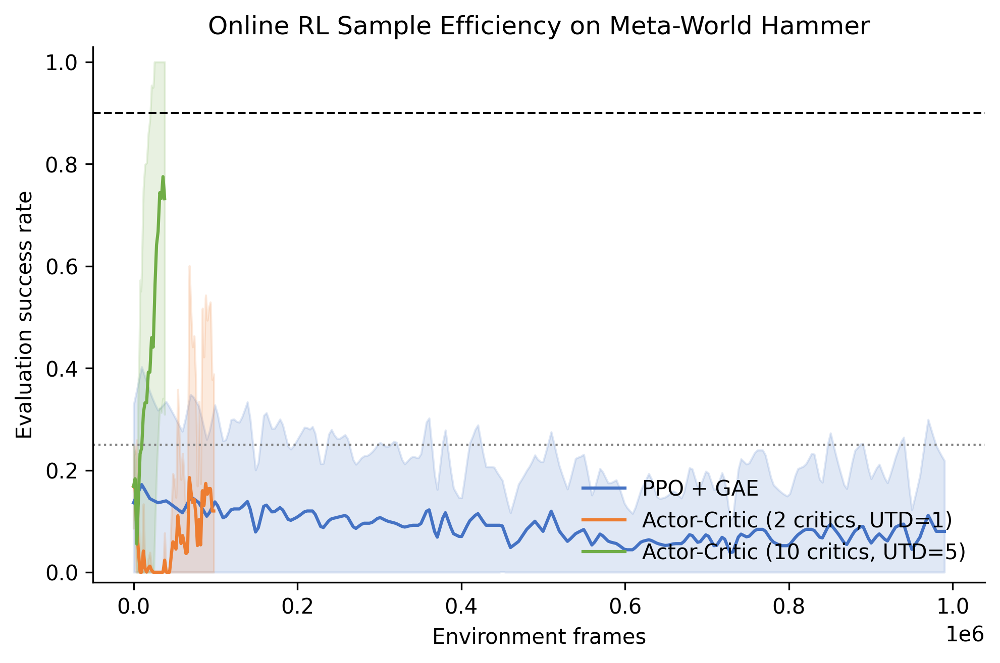
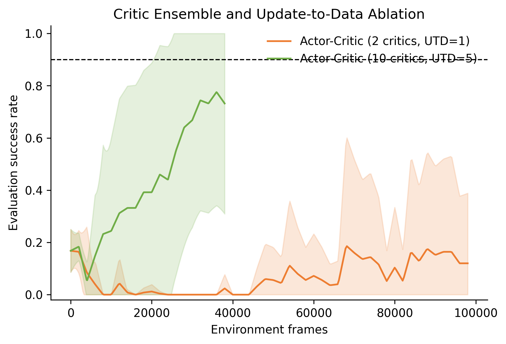
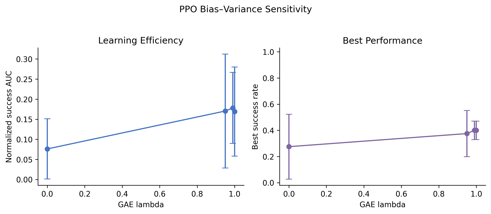
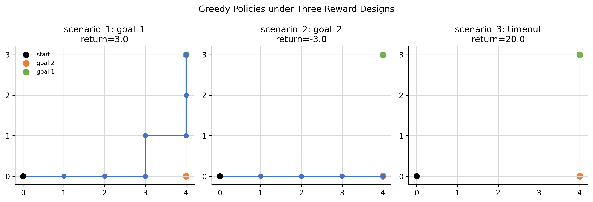
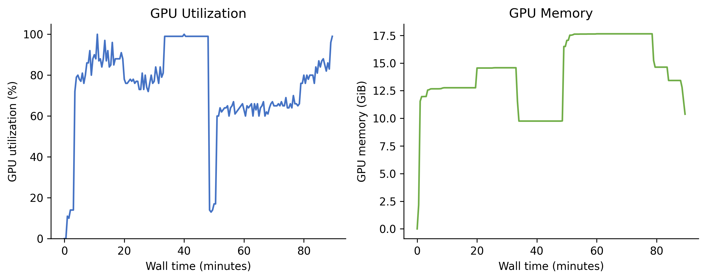

# HW2 完整实现：Online Reinforcement Learning

本目录是 CS224R Spring 2026 Homework 2 的独立 solution workspace，覆盖 tabular
Q-learning、PPO + GAE 与 off-policy ensemble actor-critic。官方 starter code 不变，
个人实现、专家轨迹、测试、原始指标、图表和双报告集中在本目录。

作者：ShaneLiu04（[GitHub](https://github.com/ShaneLiu04)）

## 完成内容

- Gridworld：epsilon-greedy、terminal-aware Q-learning 与三种 reward scenarios；
- PPO：GAE 逆序递推、returns、advantage normalization 与 clipped surrogate；
- Off-policy：BC、randomized clipped double-Q、critic ensemble、Polyak target update
  和 actor update；
- 6 个单元/集成测试，覆盖手算 GAE、PPO update、BC、critic/actor 与 Gridworld；
- 恢复官方 upstream zip 中的 20 条 hammer demonstrations；
- PPO、标准 actor-critic、高 UTD actor-critic 的多随机种子实验；
- GAE lambda、critic ensemble/UTD、Gridworld sample efficiency 等消融；
- 7 组实验图、逐 seed CSV、资源利用率记录与 handout submission CSV；
- 两份中文主体、保留英文术语的双栏 LaTeX/PDF 报告。

## 目录

```text
homework2-online-rl/
├── code/                         # 官方框架与完整算法实现
│   ├── gridworld_q_learning.py
│   ├── on_policy.py
│   ├── off_policy.py
│   ├── run_grid_experiments.py
│   ├── demos/                    # 20 条官方 hammer demonstrations
│   └── tests/
├── analysis/plot_results.py      # 聚合、制图、报告宏与 CSV 导出
├── artifacts/
│   ├── raw/                      # 原始 eval CSV、Gridworld JSON、资源指标
│   ├── figures/                  # PNG/PDF 图与汇总指标
│   └── submission/               # 题面要求的三份 learning-curve CSV
├── reports/
│   ├── assignment_report/        # 作业学术报告
│   └── interview_guide/          # 求职面试知识总结
├── setup_autodl.sh               # MuJoCo/Python/CUDA 环境
└── launch_experiments.sh         # 全部并行实验
```

## 核心公式与实现映射

GAE：

```text
delta_t = r_t + gamma * (1 - done_t) * V(s_{t+1}) - V(s_t)
A_t = delta_t + gamma * lambda * (1 - done_t) * A_{t+1}
return_t = A_t + V(s_t)
```

PPO：

```text
ratio = exp(log_prob_new - log_prob_old)
policy_loss = -mean(min(ratio * A, clip(ratio, 1-eps, 1+eps) * A))
```

Randomized clipped double-Q：

```text
next_action ~ policy(next_state)
target = reward + discount * min(Q_target_i, Q_target_j)
critic_loss = mean_k MSE(Q_k(state, action), target)
actor_loss = -mean_k Q_k(state, policy(state))
```

## 本地测试

```bash
cd solutions/spring2026/homework2-online-rl/code
python -m pytest -q
python gridworld_q_learning.py
```

## AutoDL 复现

```bash
cd /root/autodl-tmp/cs224r-hw2/workspace
bash setup_autodl.sh
bash launch_experiments.sh
```

环境变量由 launcher 设置：

```text
MUJOCO_GL=egl
PYOPENGL_PLATFORM=egl
```

原课程环境依赖已下线的 MuJoCo 2.1 tarball。本工作区使用当前 `mujoco` 与 Meta-World，
并在 `mw.py` 中兼容四元组/五元组 step API；observation、action、binary success、
action repeat 和 episode duration 保持作业定义。

主实验协议：

- PPO：1M frames，3 seeds，50 evaluation episodes；
- Off-policy baseline：2 critics、UTD=1、100k frames、5 seeds；
- High-UTD：10 critics、UTD=5、40k frames、5 seeds；
- GAE ablation：lambda = 0、0.95、0.99、1，200k frames、每项 2 seeds；
- Gridworld：30 seeds，episodes、alpha 与 gamma sweeps。

## 实验结果图



主图使用 environment frames 作为横轴，比较的是 sample efficiency。PPO 使用最新
rollout；off-policy 方法通过 replay 反复利用 transition，并以 demonstrations 跨越
sparse-reward exploration barrier。



UTD=5 增加每条环境数据对应的 critic updates，10-critic ensemble 则提供更多随机
double-Q 组合。图中同时保留跨 seed 方差，避免只展示最好的一条曲线。



GAE 图分别报告 success AUC 与 best success。AUC 衡量学习过程，best score 衡量是否在
短 budget 内达到高性能；两者不能互相替代。



三个 scenario 的 dynamics 完全相同，reward design 单独改变 greedy policy。正 step
reward 导致 agent 主动延迟终止，是 reward hacking 的最小可计算例子。



Meta-World simulation 主要消耗 CPU，actor/critic 网络较小。多个独立 seed 与消融并行
既提高 GPU throughput，也直接增加统计证据；没有新问题时不运行无解释价值任务。

完整数据：

- [`artifacts/figures/summary_per_seed.csv`](artifacts/figures/summary_per_seed.csv)
- [`artifacts/figures/summary_aggregate.json`](artifacts/figures/summary_aggregate.json)
- [`artifacts/submission/`](artifacts/submission/)
- [`reports/assignment_report/main.pdf`](reports/assignment_report/main.pdf)
- [`reports/interview_guide/main.pdf`](reports/interview_guide/main.pdf)

## 学术诚信

本目录用于个人学习、研究复现和求职知识整理。若正在修读相关课程，应遵守 honor code，
不要直接提交或公开传播个人 solution。官方材料版权归 Stanford University 与课程团队。

作业指南：
[assignments/spring2026/homework2-online-rl](../../../assignments/spring2026/homework2-online-rl/README.md)。
