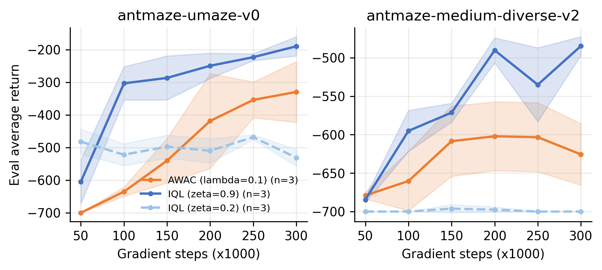
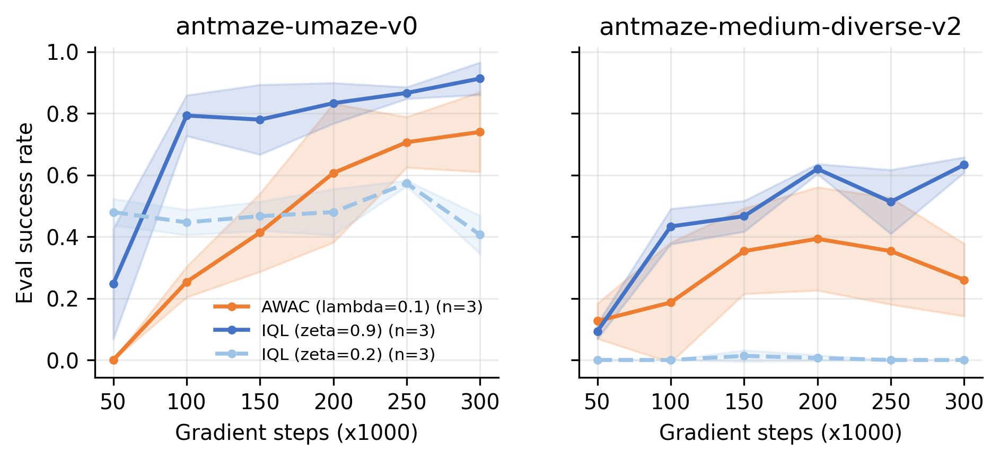
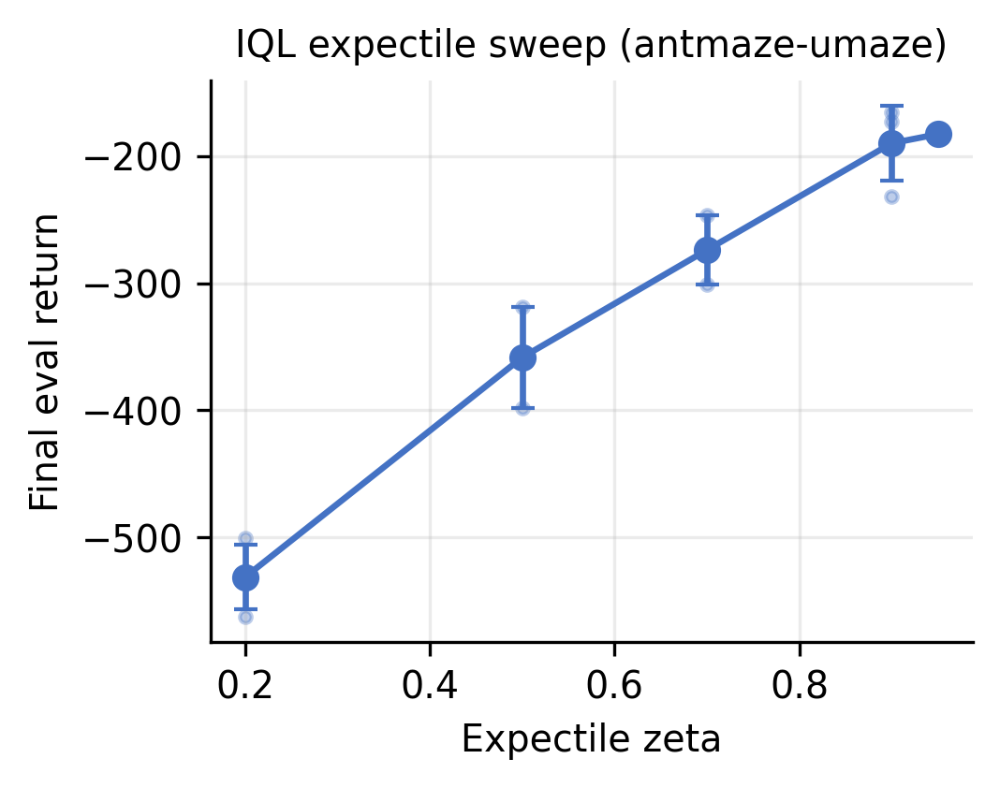
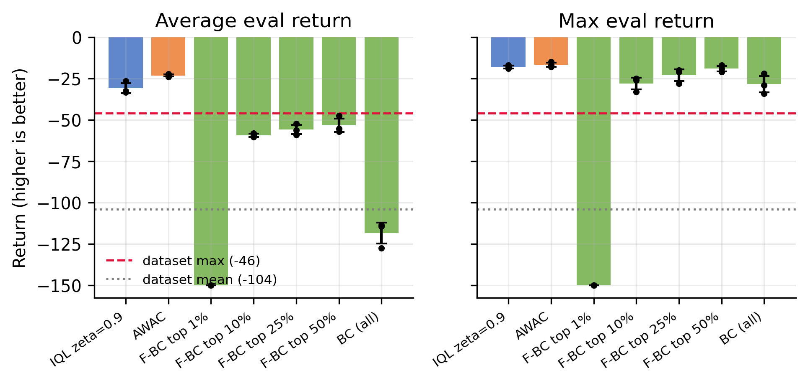
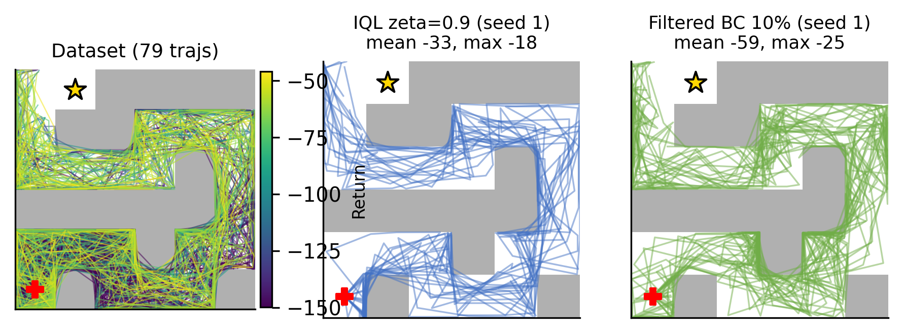
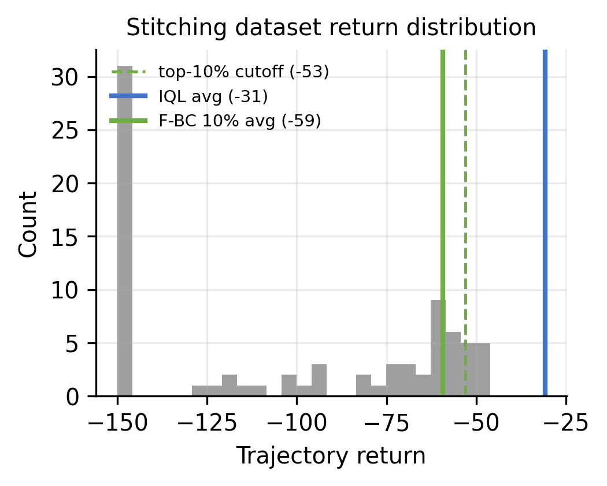

# HW3 完整实现：Offline Reinforcement Learning

本目录是 CS224R Spring 2026 Homework 3 的独立 solution workspace，覆盖 AWAC、
IQL 与 PointMass 上的 stitching。官方 starter code 不变，个人实现、测试、原始指标、
图表和双报告集中在本目录。

作者：ShaneLiu04（[GitHub](https://github.com/ShaneLiu04)）

## 完成内容

- AWAC：advantage-weighted regression，权重 `exp(A/λ)` 在反向传播前 detach 并截断到 50；
- AWAC critic：clipped double-Q，目标动作为 `a' ~ π(·|s')`，终止步不再 bootstrap；
- IQL：expectile 回归拟合 `V`，Q 的目标是 `r + γ(1-d)V(s')`，优势为 `Q-V`；
- 21 个单元测试，覆盖 expectile 权重、TD 目标、终止掩码、AWR 权重与优势定义；
- AntMaze u-maze 与 medium-diverse 的三种子 AWAC / IQL，以及 `ζ`、`λ` 扫描；
- PointMass 拼接数据集上的 IQL、AWAC 与 Filtered BC，含过滤比例扫描；
- 9 组实验图、逐 seed `metrics.csv`、autograder CSV 与两份中文双栏报告。

## 目录

```text
homework3-offline-rl/
├── code/                         # 算法实现与单元测试
├── analysis/plot_results.py      # 聚合、制图、报告宏与 CSV 导出
├── run_experiments.py            # 有界并行的实验调度
├── artifacts/
│   ├── raw/runs/                 # 每个 seed 的 metrics.csv
│   ├── figures/                  # PNG/PDF 图
│   ├── submission/csv_data/      # 题面要求的逐 seed CSV
│   └── summary.json
└── reports/
    ├── assignment_report/        # 作业学术报告
    └── interview_guide/          # 求职面试知识总结
```

## 核心公式

AWAC 策略损失：

```text
L = -mean( log π(a|s) * exp(A(s,a) / λ) )
A(s,a) = Q(s,a) - Q(s, a_π),   a_π ~ π(·|s)
```

IQL 的 expectile 与 Q 目标：

```text
L2^ζ(δ) = |ζ - 1{δ<0}| * δ^2
y = r + γ (1-d) V(s')
A(s,a) = Q(s,a) - V(s)
```

## 实验协议

- AntMaze：batch 256，`λ=0.1`，`3×10^5` 步，每 `5×10^4` 步评估 50 条轨迹；
- 作业比较的 expectile 是 `ζ=0.2` 与 `ζ=0.9`，medium 使用 u-maze 上更好的 `ζ=0.9`；
- PointMass：`5×10^4` 步，20 条评估轨迹，Filtered BC 保留回报最高的 10% 轨迹；
- u-maze 使用 `antmaze-umaze-v0`。公开镜像上的 `antmaze-medium-diverse-v0` HDF5
  被截断，medium 实验改用修复后的 `antmaze-medium-diverse-v2`（`10^6` 条转移）；
- 奖励在训练和评估时都减 1，使目标步为 0、其余步为 -1。

## 实验结果图



u-maze 上 AWAC（`λ=0.1`）最终回报 `-329.9 ± 93.0`，IQL（`ζ=0.9`）为
`-189.9 ± 29.6`，`ζ=0.2` 为 `-531.3 ± 25.2`。medium 上三者分别是
`-625.6 ± 40.0`、`-484.8 ± 12.2` 和 `-700.0`。`ζ=0.2` 的三个 medium 种子成功率都是 0。





u-maze 上最终回报随 `ζ` 升高。作业只在 0.2 和 0.9 之间选择，0.9 更高，因此 medium
与拼接实验使用 0.9。扫描里 `ζ=0.95` 的两个种子与 0.9 接近。



数据集最大回报是 -46，均值约 -104。IQL（`ζ=0.9`）的平均评估回报是 `-30.8 ± 3.0`，
高于 -46；Filtered BC（10%）是 `-59.4 ± 0.9`，低于 -46。平均回报超过数据集最大值，
说明典型轨迹短于数据里最好的一条。





## 本地测试

```bash
cd solutions/spring2026/homework3-offline-rl/code
python -m pytest -q
```

完整数据：

- [`artifacts/summary.json`](artifacts/summary.json)
- [`artifacts/submission/csv_data/`](artifacts/submission/csv_data/)
- [`reports/assignment_report/main.pdf`](reports/assignment_report/main.pdf)
- [`reports/interview_guide/main.pdf`](reports/interview_guide/main.pdf)

## 学术诚信

本目录用于个人学习、研究复现和求职知识整理。若正在修读相关课程，应遵守 honor code，
不要直接提交或公开传播个人 solution。官方材料版权归 Stanford University 与课程团队。

作业指南：
[assignments/spring2026/homework3-offline-rl](../../../assignments/spring2026/homework3-offline-rl/README.md)。
